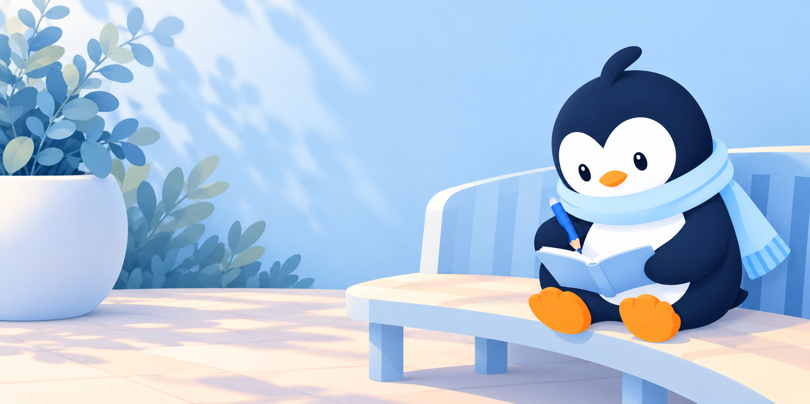
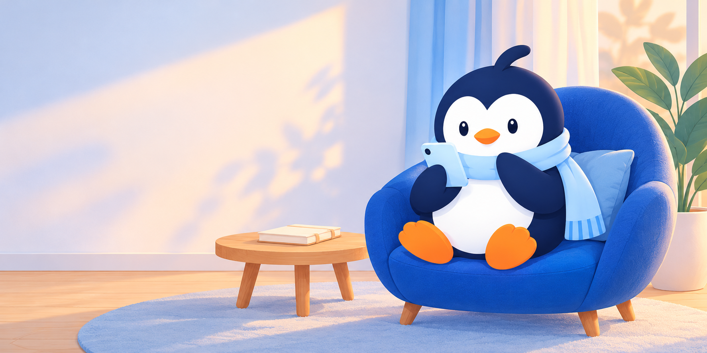

# Screen scenes 07

30 October 2026. Six illustrations extend [ScreenScenes06](../ScreenScenes06/README.md), giving the main screen families distinct Pingu activities. The owner subsequently accepted these for the asset library. Native app behaviour and placements remain unchanged.

## New originals

| Screen | Artwork |
| --- | --- |
| Welcome / onboarding | [Welcome path](SceneWelcomePathV1.png) |
| Write or edit a reflection | [Reflection garden](SceneReflectionGardenV1.png) |
| Refine wording | [Refine workbench](SceneRefineWorkbenchV1.png) |
| Add their reply / more context | [Read and reply](SceneReplyReadingV1.png) |
| Voice input introduction / ready state | [Voice corner](SceneVoiceCornerV1.png) |
| Settings / earlier-journal recovery introduction | [Personal shelf](SceneKeepsakeShelfV1.png) |

All six are opaque **1774 × 887 RGB PNGs**, copied unchanged from the built-in image generator. [Exact prompts, reference, dimensions and hashes](provenance.json) are saved alongside them. Each generation used the existing Practising Pingu as the character/style reference.

## Review gallery

[Open the nine-scene gallery](../../../../../ArtReview07/index.html) to compare these six with the three from set 06. The gallery uses the originals without cropping or recompression.

### Welcome path

### Reflection garden

### Refine workbench

### Read and reply

### Voice corner

### Personal shelf

## Placement and state rules

### Supporting screens

| Screen/state | Recommended existing artwork treatment |
| --- | --- |
| Log in, reset password, new password | Small [Welcome Pingu](../Expansion01/PinguWelcomeV1.png) above the form, or no illustration with keyboard/larger text |
| Check email | Small [Considering Pingu](../Expansion05/PinguConsideringV1.png); native status text remains authoritative |
| Privacy and data | Small [Privacy accent](../Expansion01/BrandPrivacyV1.png) beside accurate wording; no implied encryption claim |
| Earlier-data preview | Personal shelf only in the introduction; data preview rows remain readable |
| Loading, offline, validation, failure | Native status/error first; optional small [Thoughtful Pingu](../Expansion01/PinguThoughtfulV1.png), never a success pose |
| Saved/completed | Small [Greeting Pingu](../Expansion05/PinguGreetingV1.png), displayed only after success |
| Calendar, entry detail, active editing | No extra scene; prioritise calendar and user-authored content |

- Large artwork belongs in a bounded hero or introduction area, above native copy and controls. Preserve the existing screen proportions. Collapse or hide it while editing, when the keyboard opens, or at larger text sizes.
- Use aspect fit initially. Off-centre Pingu poses are not safe for automatic portrait centre crops. Welcome also needs a separate portrait composition if used full-screen.
- Keep the Journal calendar free of additional artwork. Use the existing Journal desk on empty/intro states; entry details keep the person's writing first.
- Refine art represents comparing wording; it does not mean a live AI service is available or a request succeeded.
- Voice corner is optional ready-state decoration. It must not replace live recording indicators, permission controls, transcript review or errors.
- Personal shelf can introduce Settings or earlier-data recovery. It makes no security, encryption, backup or completed-restore claim.
- Keep native text and controls outside the image. The PNGs contain no interface copy. Native colour/font tokens remain unchanged.
- These raster scenes have no separate animation layers or dark-mode variants.

## Validation

All originals were opened and visually reviewed for character identity, differentiated activity, text absence and obvious anatomy issues. Reply and shelf include small natural green/wood accents; those are illustration details, not new UI colour tokens. PNG decoding, dimensions, aspect ratio and source-copy hashes were verified. Native placement, keyboard, Dynamic Type and VoiceOver remain untested for these assets.
