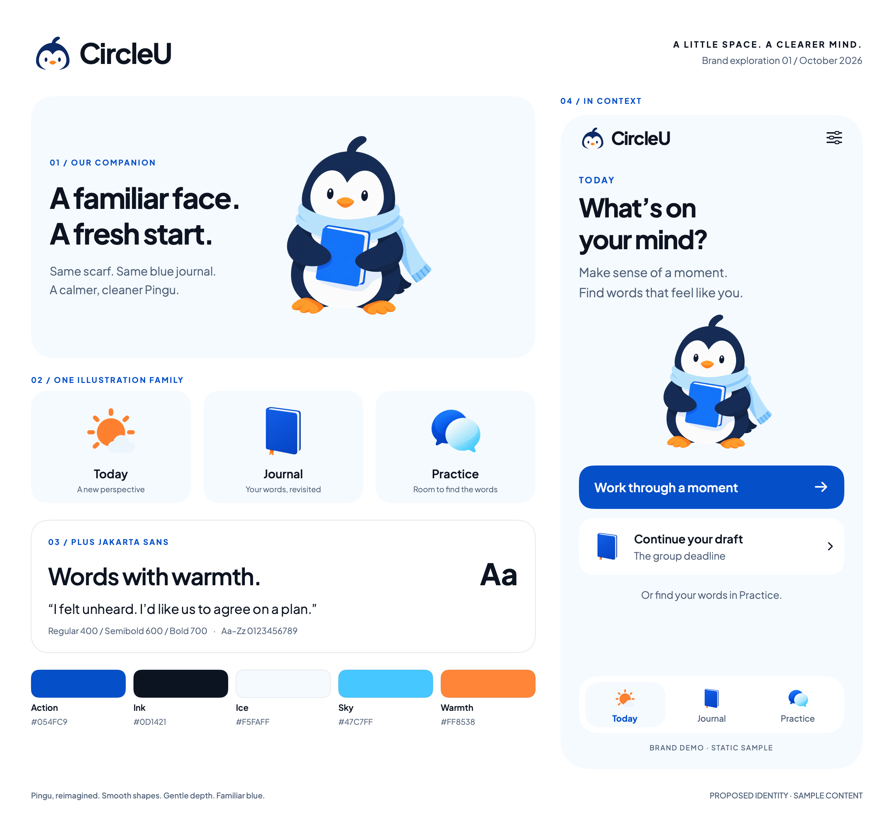

# CircleU brand demo 01

23 October 2026. Owner-authorized visual exploration using the recommended softly shaded Pingu direction and Plus Jakarta Sans. This demonstrates an identity for discussion; it does not approve production replacements.

24 October feedback: the owner accepted the demo (“its good”). Carry its Pingu character, font pairing and palette into the next prototype refinement. This records acceptance of the visual direction, not a completed production asset specification.

The authorized follow-up is now available as [Demo 02 — Journal, Practice and editor previews](flow-previews.md), including a softer Practice icon. The original board below remains the Demo 01 comparison.

[View Today at phone size](../swiftui-previews/brand-today.png) · [Branding guideline](../branding-guideline.md) · [SwiftUI source](../../../Prototypes/CircleUVisualPrototype/Sources/CircleUVisualPrototype/BrandDemo.swift)

## What is being tried

- One face for the simplified penguin logo and full-body avatar: navy silhouette, white face, small open eyes and closed orange beak.
- Familiar scarf, blue journal and warm feet retained from the original character; smooth outlines and restrained shading replace sketch marks.
- Today/sun, Journal/book and Practice/conversation illustrations, with native symbols retained for functional controls.
- Actual Plus Jakarta Sans lettering in the wordmark, headings, labels and body. Regular, semibold and bold specimens appear on the board.
- Existing source palette: action blue #054FC9, ink #0D1421, ice #F5FAFF and sky #47C7FF; proposed orange accent #FF8538. The swatches and UI fills use these exact values; generated art has tonal variations.
- A static Today proposal with one new-reflection action and one resume-draft card. Practice remains available through the three-tab navigation. Copy and layout are a brand application proposal, not a verified new Figma state.

## Assets and provenance

All five artwork PNGs were generated with the image-generation tool for this demo and copied without pixel editing into the isolated package. The first glossy avatar draft was refined; only the refined version is bundled. Each saved file is a 1254 × 1254 transparent raster, not an editable vector master. [Generation prompts](prompts.json) preserve the creative instructions.

| File | Role |
| --- | --- |
| [BrandLogo.png](../../../Prototypes/CircleUVisualPrototype/Sources/CircleUVisualPrototype/Resources/BrandArtwork/BrandLogo.png) | Simplified head beside the wordmark |
| [BrandAvatar.png](../../../Prototypes/CircleUVisualPrototype/Sources/CircleUVisualPrototype/Resources/BrandArtwork/BrandAvatar.png) | Full-body character |
| [BrandToday.png](../../../Prototypes/CircleUVisualPrototype/Sources/CircleUVisualPrototype/Resources/BrandArtwork/BrandToday.png) | Sun/cloud illustration |
| [BrandJournal.png](../../../Prototypes/CircleUVisualPrototype/Sources/CircleUVisualPrototype/Resources/BrandArtwork/BrandJournal.png) | Blue notebook illustration |
| [BrandPractice.png](../../../Prototypes/CircleUVisualPrototype/Sources/CircleUVisualPrototype/Resources/BrandArtwork/BrandPractice.png) | Paired conversation bubbles |

The original [Pingu mascot](../../../Circleu/Assets.xcassets/PinguMascot.imageset/pingu-mascot.png) informed the avatar; the refined avatar informed the new logo. Original app assets remain unchanged.

The actual variable font comes from the [official Google Fonts source distribution](https://github.com/google/fonts/tree/main/ofl/plusjakartasans). [Bundled font](../../../Prototypes/CircleUVisualPrototype/Sources/CircleUVisualPrototype/Resources/BrandFonts/PlusJakartaSans.ttf) and [SIL Open Font License 1.1](../../../Prototypes/CircleUVisualPrototype/Sources/CircleUVisualPrototype/Resources/BrandFonts/OFL-PlusJakartaSans.txt) are retained together. It is registered within the renderer/preview process only. Lettering is native text, not generated artwork.

## Review boundaries and next decisions

The standalone SwiftUI preview compiles and exports the board (2304 × 2144 pixels) and Today sample (780 × 1688 pixels) through macOS ImageRenderer at 2× scale. CoreText resolved the bundled variable font as `PlusJakartaSans-Regular_ExtraLight` and verified its family as Plus Jakarta Sans; the view applies regular/semibold/bold weights. Both exports were visually inspected for missing artwork and clipped text. Controls are static; content is invented. This is not an iPhone Simulator capture, physical-device test, usability study, or proof of the planned local-storage behavior. Figma was not updated in this pass; connector plan access remains a separate limitation.

Review whether the new Pingu feels mature enough, whether the font suits the character, and whether the illustration size leaves enough room for writing. The Today sample includes the icons at 32 points to expose small-size tradeoffs.

Before production adoption: simplify the approved logo into a vector/monochrome master; normalize icon optical size and shading (Practice currently has more gradient than Today); prepare small-size favicon/app-icon treatments; test light/dark backgrounds, larger text, language coverage and accessibility contrast. Full app-icon and favicon export sets are not part of this first concept board. Generated artwork is a design exploration, not a final export specification.
