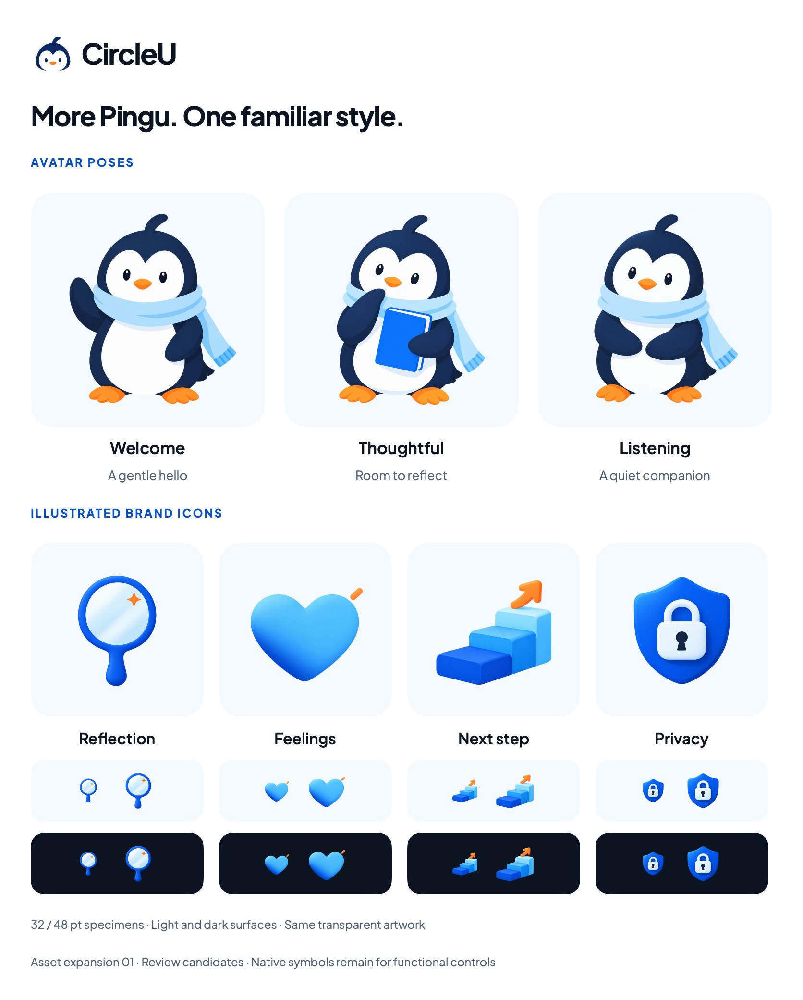

# CircleU illustrated asset library — expansion 01

24 October 2026. The owner requested more illustrated brand icons and Pingu avatars, saved in project storage. This set extends the accepted softly shaded Pingu direction without replacing existing artwork. New assets are review candidates, not approved production replacements.

[Pingu activity set 01](pingu-activities.md) adds writing, reading, practising, stretching and a quiet-breath pose. The [motion proposal](../motion-guideline.md) recommends how to introduce restrained animation later.

## Files and intended use

All seven originals are separate transparent 1254 × 1254 RGBA PNGs in [BrandArtwork/Expansion01](../../../Prototypes/CircleUVisualPrototype/Sources/CircleUVisualPrototype/Resources/BrandArtwork/Expansion01). Total original size: 5,095,317 bytes. They are copied directly from the built-in image-generation tool without pixel editing. [Exact prompts, references, dimensions and SHA-256 hashes](asset-expansion-01-prompts.json) are retained for provenance. Earlier avatar, logo, Journal, Today and Practice assets remain unchanged.

| Asset | Suggested placement |
| --- | --- |
| [PinguWelcomeV1.png](../../../Prototypes/CircleUVisualPrototype/Sources/CircleUVisualPrototype/Resources/BrandArtwork/Expansion01/PinguWelcomeV1.png) | Introduction or welcome, a small wave |
| [PinguThoughtfulV1.png](../../../Prototypes/CircleUVisualPrototype/Sources/CircleUVisualPrototype/Resources/BrandArtwork/Expansion01/PinguThoughtfulV1.png) | Reflection prompt or quiet pause; retains the familiar journal |
| [PinguListeningV1.png](../../../Prototypes/CircleUVisualPrototype/Sources/CircleUVisualPrototype/Resources/BrandArtwork/Expansion01/PinguListeningV1.png) | Supportive introduction or listening prompt |
| [BrandReflectionV1.png](../../../Prototypes/CircleUVisualPrototype/Sources/CircleUVisualPrototype/Resources/BrandArtwork/Expansion01/BrandReflectionV1.png) | Labelled Reflection accent, mirror motif |
| [BrandFeelingsV1.png](../../../Prototypes/CircleUVisualPrototype/Sources/CircleUVisualPrototype/Resources/BrandArtwork/Expansion01/BrandFeelingsV1.png) | Labelled Feelings accent, heart motif |
| [BrandNextStepV1.png](../../../Prototypes/CircleUVisualPrototype/Sources/CircleUVisualPrototype/Resources/BrandArtwork/Expansion01/BrandNextStepV1.png) | Optional next-step introduction; never a reward or required progression |
| [BrandPrivacyV1.png](../../../Prototypes/CircleUVisualPrototype/Sources/CircleUVisualPrototype/Resources/BrandArtwork/Expansion01/BrandPrivacyV1.png) | Privacy information beside accurate text; no claim of encryption, verified security or local-only behavior |

## Usage rules

- Keep the original Pingu face, crest, scarf, proportions and navy/white/orange identity across poses. These are mascot poses, not user-selected profile avatars or an emotion-detection feature.
- Use modest illustrations on welcome, empty or transition surfaces. Keep the main writing/editor area calm. Listening and thoughtful poses offer alternatives to an indiscriminate cheerful expression; they should not imply that recording is active.
- Use illustrated icons for labelled brand accents. Continue using native symbols for back, close, Edit, Copy, microphone and deletion controls. Do not add these to the calendar header.
- Render with aspect fit and transparent padding intact; do not stretch or crop. Apply appropriate decorative/meaningful accessibility handling at integration time.
- The catalog shows the same artwork on light and dark surfaces at 32/48 points. These are visual comparison specimens, not alternate dark-mode assets, optical-size masters or an accessibility certification. Reflection and Next step are the more detailed motifs and should retain labels.
- Palette and typography stay as defined in the [branding guideline](../branding-guideline.md). Generated pixels have tonal variations; they do not redefine source color tokens. Assets are raster illustrations, not editable SVG masters, monochrome icons or favicon exports.

## Evidence and next review

The standalone [SwiftUI catalog](../../../Prototypes/CircleUVisualPrototype/Sources/CircleUVisualPrototype/BrandAssetLibraryPreview.swift) uses the existing artwork loader, colors and actual Plus Jakarta Sans font. It has a named Canvas preview and is exported by the existing renderer. Full-resolution assets, transparency, padding and the rendered catalog are checked in this task; no production screen, Figma, Firebase, storage, logo, font or palette changes are implied.

Next: review the poses and labelled icon meanings in context before choosing screen placements. Small-size simplification, dark-mode integration and physical-device/accessibility checks remain implementation work.
