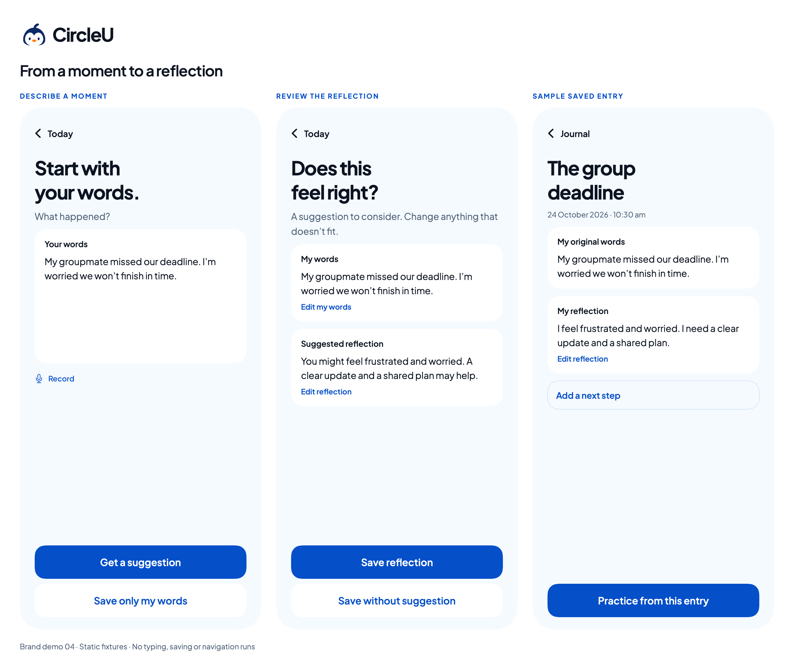
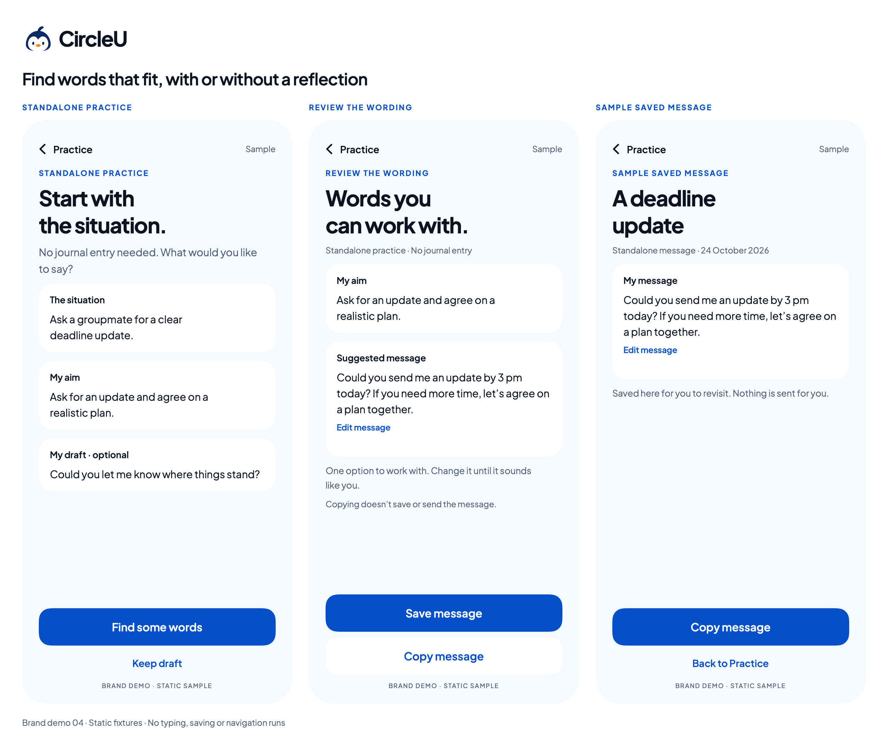
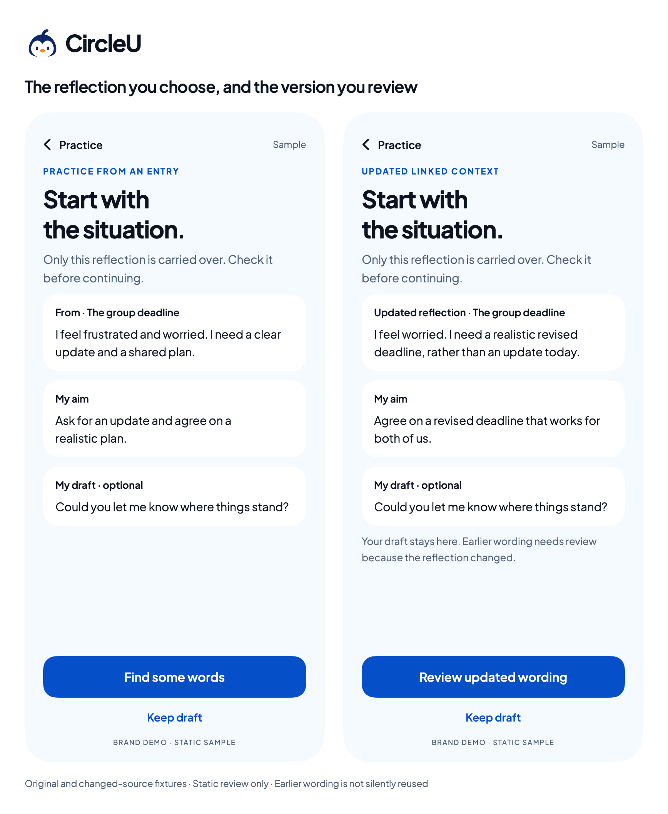

# Brand demo 04 — core journeys

24 October 2026. Owner approved continuing the [prototype milestone plan](../../superpowers/plans/2026-10-24-prototype-review-milestone.md). These are immutable SwiftUI sample screens, extending the accepted brand with the existing font/colors/helpers. Actions and fields are static. No actual user content is included.

## Reflection route

[Capture](../swiftui-previews/brand-04-capture.png) · [Reflection review](../swiftui-previews/brand-04-reflection.png) · [Saved detail](../swiftui-previews/brand-04-entry.png)

Capture keeps the user's words central and offers Review a reflection or Save only my words. Review separates original words from a tentative interpretation, with distinct editing affordances and the same words-only exit. Saved detail shows an accepted sample interpretation, keeps the original words and makes both a next step and linked practice optional. Saving is represented by this detail, without a separate success screen.

Copy/hierarchy are proposals derived from the documented Draft 02 Capture `11:101`, Reflection `11:102` and Entry `11:103`, not a fresh Figma translation. The saved example represents acceptance/correction rather than an automatic verbatim transfer of the tentative suggestion. The existing [reflection editor](../swiftui-previews/brand-02-edit-reflection.png) remains the editing specimen. No global state transition is simulated by these images.

## Practice route

[Context and goal](../swiftui-previews/brand-04-practice-context.png) · [Wording](../swiftui-previews/brand-04-wording.png) · [Saved message](../swiftui-previews/brand-04-practice-detail.png)

Direct Practice explicitly needs no Journal entry. A situation, aim and optional draft lead to one editable sample option, with independent Save and Copy. Saved practice keeps its own detail and editing affordance; nothing is sent. These are proposals based on documented context `11:108`, wording `11:110` and detail `11:112`. Reuse the [message editor](../swiftui-previews/brand-02-edit-message.png) for editing review.

[Selected reflection context](../swiftui-previews/brand-04-linked-context.png) and [changed-source context](../swiftui-previews/brand-04-updated-context.png) show the specific accepted reflection carried over. The updated example changes both its interpretation and intended outcome; earlier wording must be reviewed again rather than silently reused. These snapshots do not implement source linking, invalidation or regeneration. Continue linked-result review with the existing Figma states `11:109`, `11:111`, `11:114` rather than duplicating every variant here.

## Existing recovery snapshots selected for walkthrough

These links reuse earlier connected Draft 02 scenarios. They are preset states and do not prove that data, clipboard or cancellation behavior works in the app.

| Review concern | Existing state |
| --- | --- |
| Keep / discard / continue editing | [Close draft, 27:1699](https://www.figma.com/design/RVLtfmIVcO8gNk5fam0Vjd?node-id=27-1699) |
| Changed original source | [Source changed, 36:416](https://www.figma.com/design/RVLtfmIVcO8gNk5fam0Vjd?node-id=36-416) |
| Preserved reflection/message edits after failed save | [Reflection failure, 36:396](https://www.figma.com/design/RVLtfmIVcO8gNk5fam0Vjd?node-id=36-396), [message failure, 36:397](https://www.figma.com/design/RVLtfmIVcO8gNk5fam0Vjd?node-id=36-397) |
| Model unavailable / manual fallback | [Model unavailable, 36:389](https://www.figma.com/design/RVLtfmIVcO8gNk5fam0Vjd?node-id=36-389) |
| Read failure versus empty day | [Empty-day sample](../swiftui-previews/brand-03-journal-empty.png), [storage read failure, 36:437](https://www.figma.com/design/RVLtfmIVcO8gNk5fam0Vjd?node-id=36-437); [locked storage, 36:411](https://www.figma.com/design/RVLtfmIVcO8gNk5fam0Vjd?node-id=36-411) remains a distinct condition |

## Verification boundaries

The standalone package builds and renders with the bundled real font. Individual screens are 390 × 844 points at 2×; phone exports and the comparison gallery were visually inspected for text/action/footer clipping. The initial ungrouped content/action layout compressed some affordances; explicit vertical groups resolved this in the final renders. Current evidence is macOS ImageRenderer only. Typing, keyboard, scrolling, save/edit/navigation, storage, model generation and voice are not implemented/tested here.

[SwiftUI source](../../../Prototypes/CircleUVisualPrototype/Sources/CircleUVisualPrototype/BrandJourneyPreview.swift) · [Package guide](../../../Prototypes/CircleUVisualPrototype/README.md)
