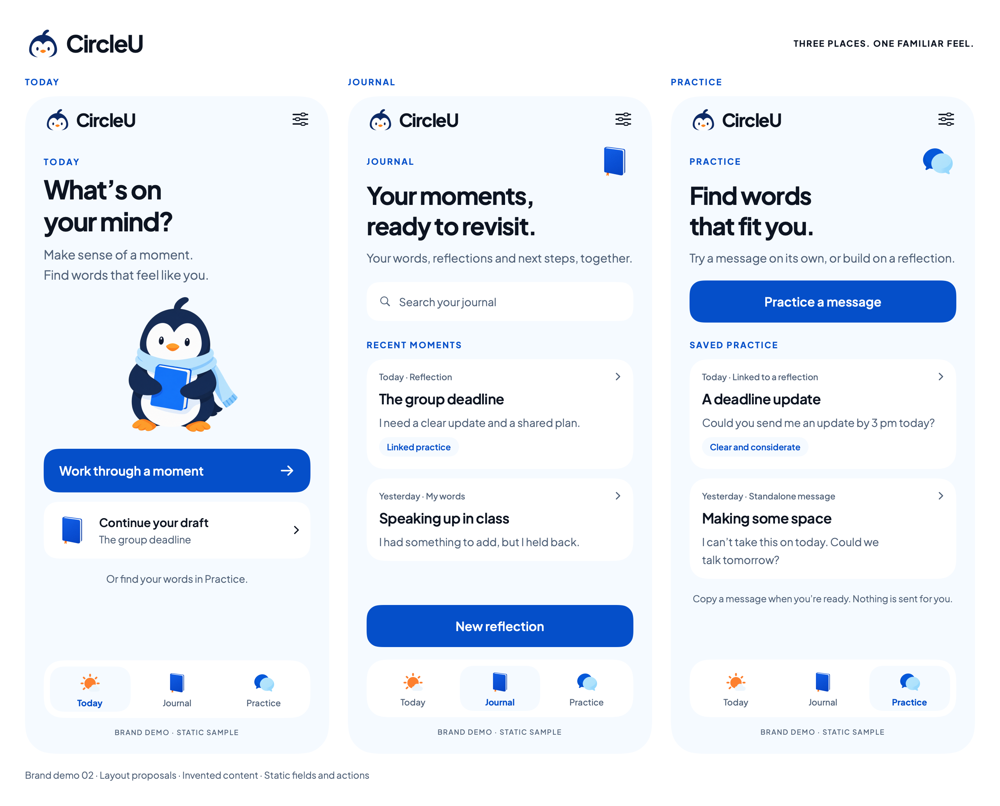
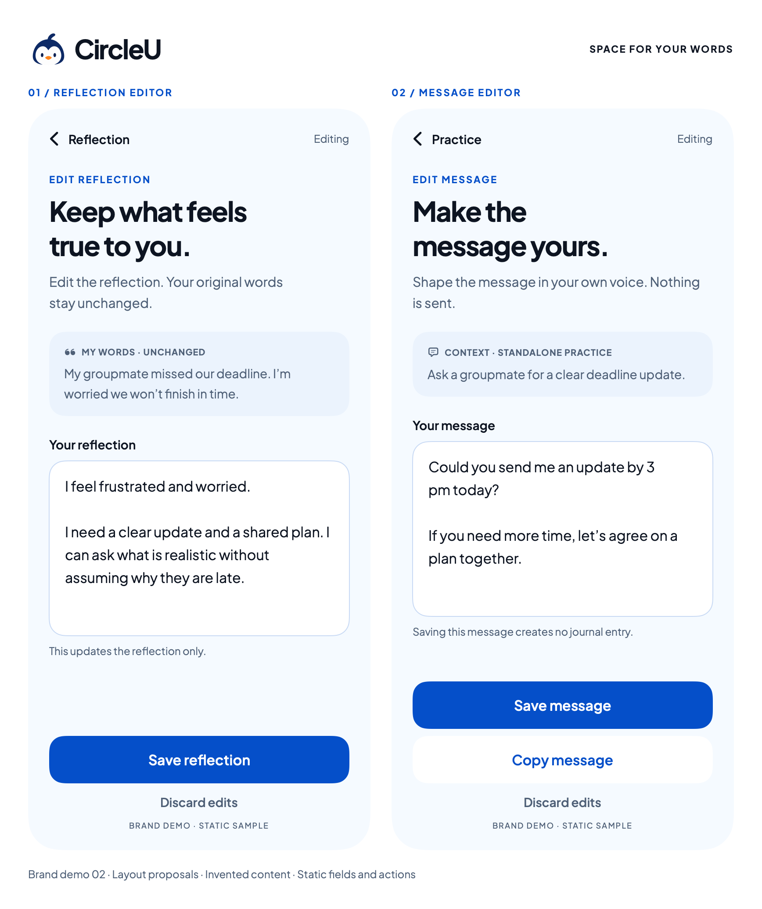

# Brand demo 02 — hubs and editing

24 October 2026. The owner accepted Demo 01 and authorized continuing its visual direction into Journal, Practice and the editing previews, with more consistent icon shading. This pass extends the isolated SwiftUI visual package. It does not implement application features or update Figma.

## Decisions applied

- Retain Demo 01's Pingu/logo, Plus Jakarta Sans, blue/ice palette and restrained orange accent.
- Keep the Today mascot and use smaller category artwork on Journal and Practice. Keep illustration out of the editing fields.
- Use a single card per saved item to reopen it; omit the earlier duplicate “Open saved entry/practice” buttons. Preserve new-reflection and new-practice actions.
- Show Journal search as a static visual affordance for the already-planned search feature. Search, cards, tabs and actions do not run.
- Distinguish linked practice from standalone messages. Reuse the invented group-deadline scenario and add a fictional class participation note and boundary-setting message to assess lists.
- Separate original words from the proposed edited reflection. Retain Save/Discard; message editing also retains Copy and explicitly says nothing is sent. Editor back navigation and discard confirmation remain flow implementation requirements, not working interactions here.
- Use the real font for all lettering. The new Practice artwork softens the bright highlight while preserving the overlapping-bubble composition. It still has gentle shading; final vector normalization remains future work.

## Individual specimens

All five screens are fixed 390 × 844 point layouts, exported at 2× scale.

| Screen | Review image |
| --- | --- |
| Today with revised Practice icon | [Today](../swiftui-previews/brand-02-today.png) |
| Journal | [Journal](../swiftui-previews/brand-02-journal.png) |
| Practice | [Practice](../swiftui-previews/brand-02-practice.png) |
| Reflection editor | [Edit reflection](../swiftui-previews/brand-02-edit-reflection.png) |
| Standalone practice editor | [Edit message](../swiftui-previews/brand-02-edit-message.png) |

[SwiftUI source](../../../Prototypes/CircleUVisualPrototype/Sources/CircleUVisualPrototype/BrandFlowPreview.swift) includes named Canvas previews and the two galleries. [Package guide](../../../Prototypes/CircleUVisualPrototype/README.md) explains the library scheme and renderer. Original Draft 02 views, original Demo 01 and production assets remain available.

## Artwork provenance

[BrandPracticeV2.png](../../../Prototypes/CircleUVisualPrototype/Sources/CircleUVisualPrototype/Resources/BrandArtwork/BrandPracticeV2.png) was edited with the built-in image-generation tool using the previous Practice PNG as input. [Exact edit prompt](practice-v2-prompt.txt). It was copied into the package without pixel editing; the previous asset is retained. The other artwork and font retain [Demo 01 provenance](README.md#assets-and-provenance).

## Scope of evidence

Verification: standalone package build and renderer passed. All five phone exports are 780 × 1688 pixels; hub and editor galleries are 2564 × 2069 and 1736 × 2069 pixels. Galleries were visually inspected, then the reflection and Practice screens rechecked after copy cleanup. No clipped text or controls were observed at these fixed sizes. The revised source icon is 1254 × 1254 RGBA with alpha spanning 0–255. The real font-family assertion passed. These checks do not cover interactive behavior or responsive text sizes.

These are macOS SwiftUI ImageRenderer specimens using invented content. This pass changes branding/layout only; editor semantics derive from the existing preview plan, with reflection still a layout proposal. Neither editor is an exact Figma translation of the new brand design. No new Figma access, app launch, Firebase operation, live keyboard/editing, clipboard, persistence, recovery or network behavior is implied.

The follow-up before production remains: working navigation and editor behavior after implementation approval, keyboard/scroll handling, larger text, VoiceOver, contrast/dark mode and physical-device checks. Small-size vector/app-icon/favicon masters remain a separate design deliverable.

Renderer note: individual exports use an explicit 390 × 844 size proposal. Hub spacing and a fixed-height static footer were adjusted after individual-image inspection exposed compressed header/footer content that was not apparent in the first gallery. The final Practice export and hub gallery were rechecked after that correction.
