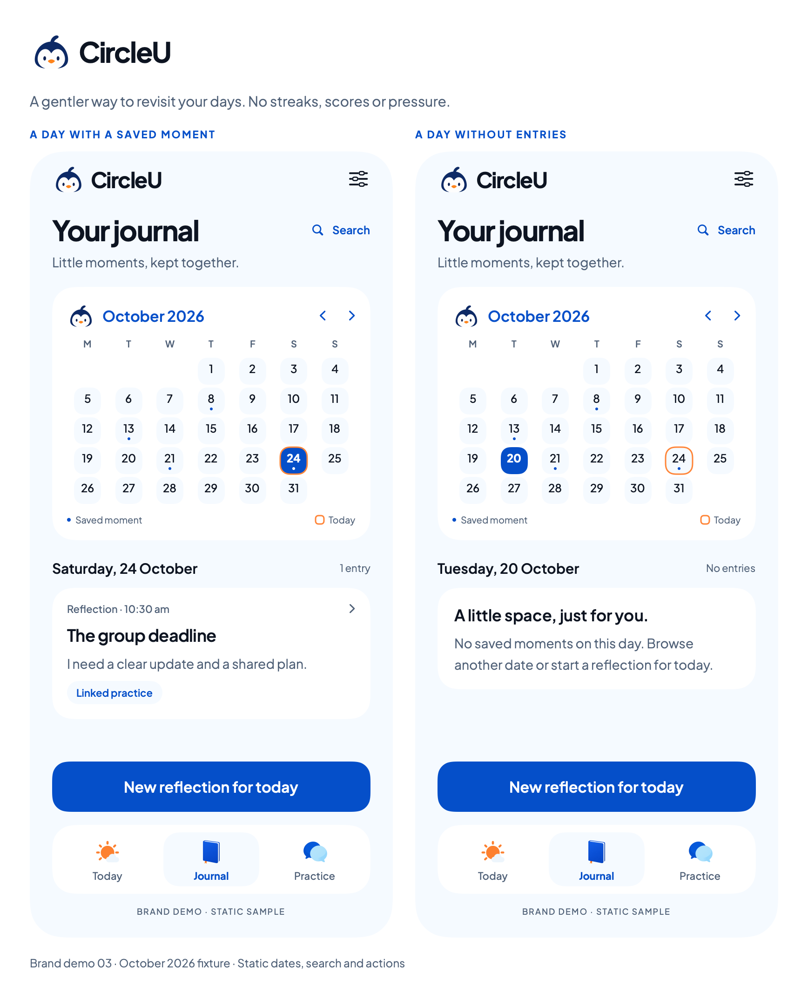

# Journal calendar — brand demo 03

24 October 2026. The owner requested a cute calendar for Journal. This static SwiftUI proposal reuses the accepted Pingu, Plus Jakarta Sans and blue/ice/orange identity. It extends date browsing within Journal, not a new top-level feature or rewards system.

[Saved-day screen](../swiftui-previews/brand-03-journal.png) · [Empty-day screen](../swiftui-previews/brand-03-journal-empty.png) · [SwiftUI source](../../../Prototypes/CircleUVisualPrototype/Sources/CircleUVisualPrototype/JournalCalendarPreview.swift)

## Visual proposal

Rounded pale-blue date tiles, a small Pingu head and gentle orange today outline provide the cute treatment. A blue fill identifies the selected day. Small dots mean at least one saved Journal reflection/note, not mood, achievement or a daily target. The selected-day heading and entry count explain the visible state alongside color cues. No streaks, scores or rewards are added.

October 2026 is a fixed Monday-first sample. October 1 is Thursday; October 24 is Saturday. Sample entry days are 8, 13, 21 and 24. The filled selection is October 24 in the saved-day specimen and October 20 in the empty-day specimen. “Today” remains October 24 in both. The month arrows, Search, dates, cards and actions are static labels. Nothing is filtered, edited or saved in this package.

The saved-day card reopens the same Journal entry in the intended flow. An empty day says there are no saved moments and offers browsing or a new reflection without guilt. “New reflection for today” makes clear that selecting a historical date does not backdate a new entry.

## Behavior to validate before implementation

- Month navigation changes the visible month without modifying entries. Provide a route back to Today and an all-entries/search view so calendar browsing never hides history permanently.
- Select a date to filter existing Journal notes/reflections; include linked-practice badges on those entries. Standalone practice remains in Practice and does not inflate Journal dots/counts. Multiple entries produce one dot and the true count/list below.
- Use the agreed local calendar/time-zone policy for date grouping; preserve timestamps. Test month boundaries, leap years, daylight saving and time-zone changes when real filtering is implemented. The English Monday-first fixture is not a final localization policy.
- Review future-date navigation, selection retention when changing months, empty month, loading/storage failure and search-return behavior in the interactive prototype. A failed load must not be displayed as an empty day.
- Compact 29-point tiles are a visual specimen. Production needs adequate hit areas, scrolling and larger-text/VoiceOver checks; selection/today/entry presence must have accessible text, not color alone.

## Evidence and scope

Built and exported using the isolated SwiftUI package on macOS. Individual specimens are 390 × 844 points at 2× scale. No full app, Simulator/device, Firebase or Figma behavior is exercised. Earlier list-only Journal and brand boards remain for comparison. Calendar sample arithmetic and the final exports are checked before the authorized Git publication; this is not runtime calendar test coverage.
