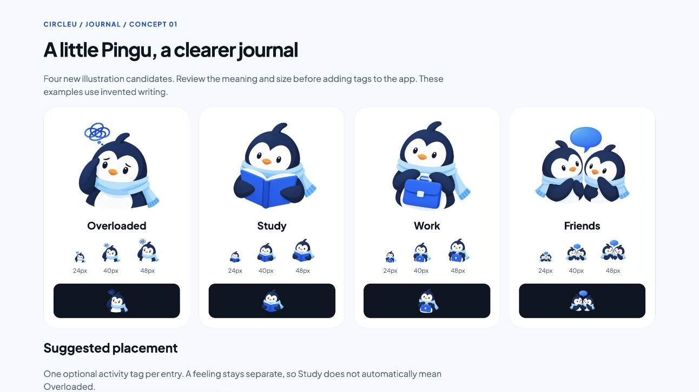
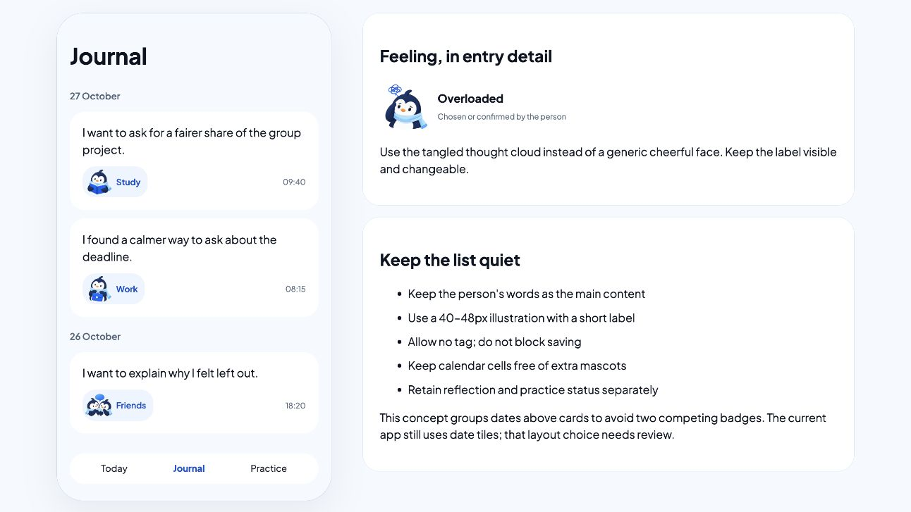

# Journal Pingu tags — review concept 01

27 October 2026. Owner requested Journal feedback, a clearer Overloaded illustration and Pingu tags for activities. Four transparent illustrations were created with built-in image generation. These are review candidates; no app tagging implementation or approved schema is implied.

## Recommended next step

Review one optional activity/context tag per entry, with a short text label. Initial candidates: Study, Work and Friends. Overloaded is a feeling, kept separately in entry detail and chosen or confirmed by the person. Existing untagged entries remain valid. No automatic classification is proposed for this pass.

The existing native Journal shows a date tile, up to three lines of original words, status icons and time. It has no activity-tag control. The concept explores dates above cards to avoid competing date/mascot badges; that grouping is a proposal, not a native change. Preserve reflection/practice status semantics and existing calendar navigation. Do not add decorative calendar icons.

Alternatives: keep date tiles and append a labelled tag (smallest layout change); group dates and place a tag beneath the excerpt (shown in the concept, calmer for multiple entries); icon-only tags (not recommended because meaning is ambiguous). No owner choice between these placements has been recorded yet.

## Assets and review

- [Static gallery and card concept](../../../Prototypes/CircleUVisualPrototype/JournalTagReview/index.html)
- [Original PNGs and exact prompts, reference and hashes](../../../Prototypes/CircleUVisualPrototype/Sources/CircleUVisualPrototype/Resources/BrandArtwork/JournalTags01/provenance.json)

PinguOverloadedV1: concerned face and tangled thought cloud. PinguStudyTagV1: open book. PinguWorkTagV1: briefcase. PinguFriendsTagV1: two penguins and a speech bubble. All keep the scarf/navy/white/blue identity. Existing source art is preserved.

Use aspect fit. 40–48-point labelled chips are the proposed minimum placement; 24-pixel examples deliberately show loss of facial/prop detail. Overloaded benefits from a larger 64–72-point detail placement. Full-resolution generated cutouts have soft/fringed lower edges, so retain as review masters until optical cleanup/export qualification. They are raster illustrations, not vector glyphs or animation rigs.

## Next implementation boundaries

Before coding: confirm labels and placement, then specify add/change/remove and unset behaviour. A saved tag would need a nullable stable identifier, migration/round-trip/export coverage and preservation across edits; do not infer activity from existing journal text. Native controls must keep labels and VoiceOver names, wrap at larger text, and preserve independent status information. Existing fonts, controls and calendar should not be redesigned incidentally.

Validation: inspected all four originals, checked PNG dimensions/RGBA alpha and hashes, and reviewed gallery at large and small display sizes. No app build or tests needed for unchanged Swift source. No native/hardware accessibility, dark-mode or semantic recognition testing is claimed.
