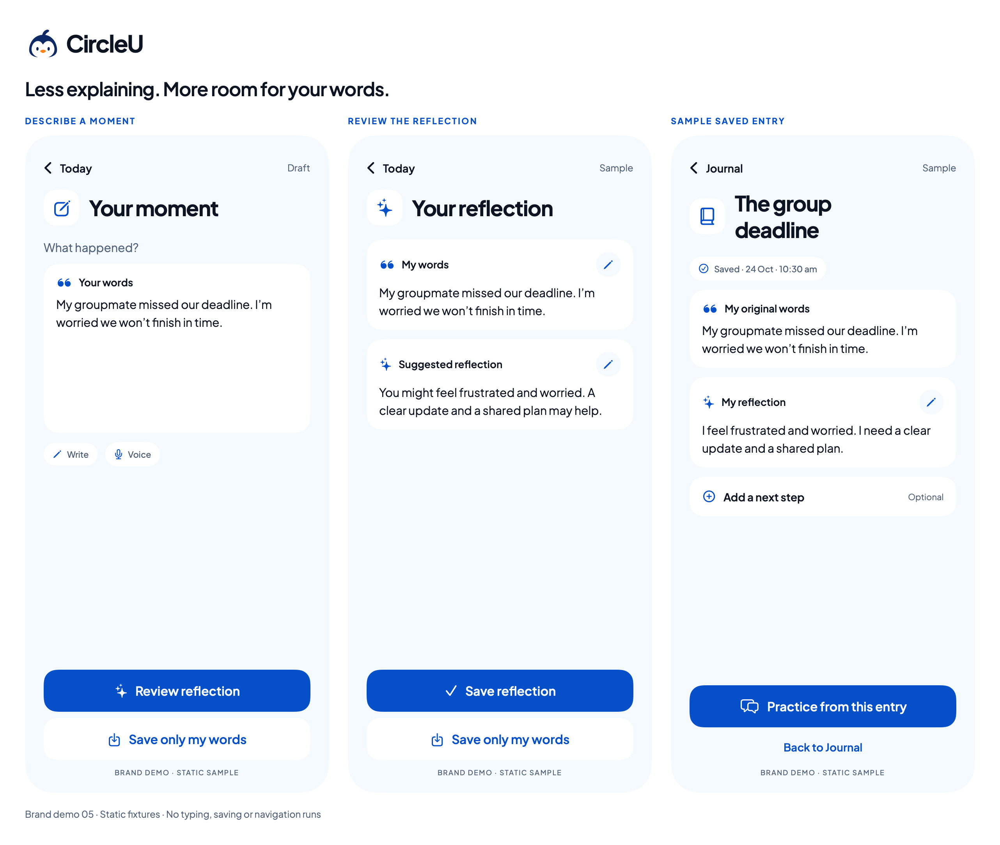
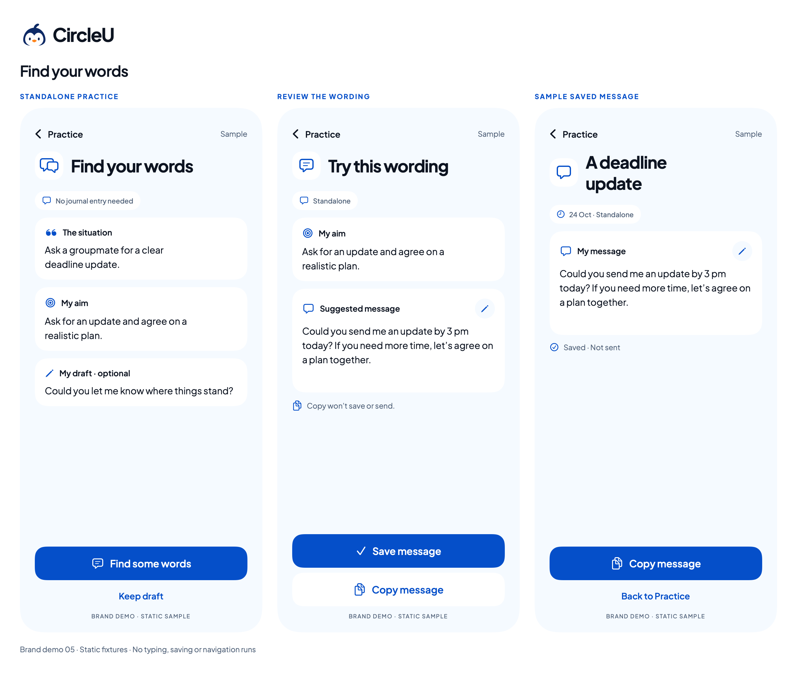

# Brand demo 05 — lighter copy and rounded icons

24 October 2026. Owner feedback: the core screens contain too much text and should use some icons. This review variant shortens interface explanations and adds native rounded-style SF Symbols, while retaining the accepted Pingu colors/font and the full invented writing/message content.

[Updated linked context](../swiftui-previews/brand-05-updated-context.png) · [Linked-context comparison](../swiftui-previews/brand-05-linked-contexts.png) · [Previous Demo 04](core-journeys.md)

## Changes to review

- Shorter headings and fewer repeated eyebrow/helper paragraphs inside the phone layouts. Actual sample account, reflection, aim and draft text remains intact.
- Quote, reflection, goal and message symbols help scan the card headers. Pencil affordances replace repeated Edit labels and retain context-specific accessibility labels such as Edit my words or Edit message.
- Labelled Write/Voice chips replace the long recording invitation. Standalone/source/date information uses short icon-and-text tags.
- Main actions retain explicit labels alongside icons: Save reflection, Save only my words, Save message and Copy message. The words-only path remains visible. Add a next step retains its Optional label.
- Saved entries retain an explicit Saved cue; saved messages say “Saved · Not sent.”
- The updated-source example retains the same user draft and a concise notice: “Draft kept. Review earlier wording.” Copy still explicitly says it will not save or send.
- Native symbols support functional meaning; these are not new raster assets, a new mascot direction or emoji replacements. Calendar views and their icon-free month header are not part of this change.

## Individual specimens

[Capture](../swiftui-previews/brand-05-capture.png) · [Reflection](../swiftui-previews/brand-05-reflection.png) · [Saved entry](../swiftui-previews/brand-05-entry.png) · [Practice context](../swiftui-previews/brand-05-practice-context.png) · [Wording](../swiftui-previews/brand-05-wording.png) · [Saved message](../swiftui-previews/brand-05-practice-detail.png) · [Original linked context](../swiftui-previews/brand-05-linked-context.png)

## Source and evidence

The existing [journey view](../../../Prototypes/CircleUVisualPrototype/Sources/CircleUVisualPrototype/BrandJourneyPreview.swift) has an opt-in `iconLed` presentation. Default rendering remains Demo 04; [renderer](../../../Prototypes/CircleUVisualPrototype/Sources/RenderPreviews/main.swift) exports both versions. Shared brand colors, actual Plus Jakarta Sans and existing sample content are reused. Existing comparison images remain available.

Standalone build/render and image checks are the verification for this static change. Each of the eight new individual screens is 390 × 844 points, exported at 2×, plus three galleries. No actual typing, editing, voice, clipboard, source invalidation, persistence or navigation is implemented. Native accessibility labels are present in source, but VoiceOver, larger text, contrast and production touch targets have not been validated. Icon-only edits are a proposal to assess in the walkthrough, not proven discoverability.
