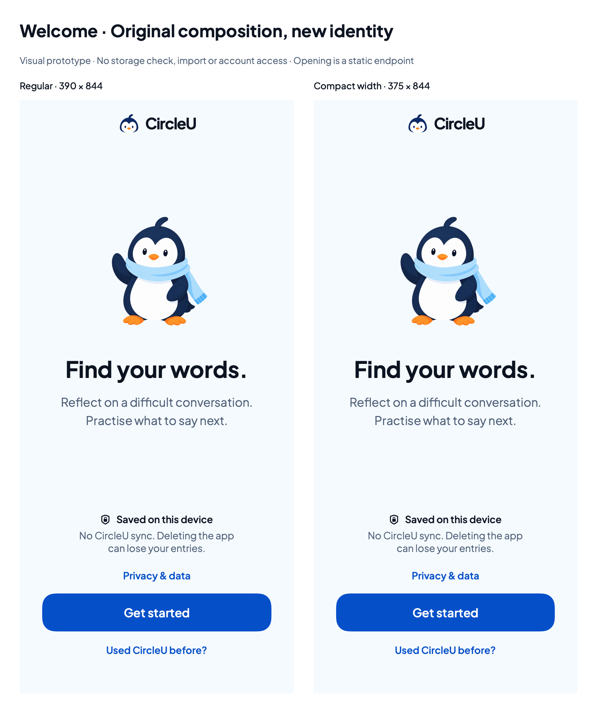

# Native onboarding review — original layout, new branding

24 October 2026. Owner-authorized isolated SwiftUI prototype. The production app and Figma remain unchanged.

Open the existing `Prototypes/CircleUVisualPrototype` package in Xcode, select the **CircleUVisualPrototype library** scheme and an iPhone destination, then open `Sources/CircleUVisualPrototype/BrandOnboardingPreview.swift`. Select **Onboarding · Welcome · phone** in Canvas. This was visually displayed on the iPhone 17 destination during this pass; it is Canvas evidence, not a newly installed Simulator app or a physical-device check.

**Device-selection correction:** the toolbar run destination above did not establish the Canvas hardware model. The owner subsequently identified the generic iPhone Duo frame. Canvas has a separate **Preview Device** menu at its lower right; select **More → iPhone 18 Pro** (or a specific iPhone 17 entry) there. Do not treat the earlier Canvas displays as model-specific iPhone 17 validation. The original-app window's Canvas was changed from Automatic–iPhone Duo to the explicit iPhone 18 Pro option; confirming the same setting in the separate onboarding package remains pending because UI automation repeatedly selected the original-app window.



## What changed

- Original composition: flexible space around the 172pt mascot/centered hero, 32pt title and illustration-to-title gap, lower action group, 32pt action-side insets, 54pt minimum primary action and 18pt radius. No fixed outer phone size or rounded device clipping inside the screen view.
- Accepted ice/blue/ink theme, existing transparent waving Pingu and logo, actual bundled Plus Jakarta Sans. New text uses semantic Dynamic Type scaling; the small wordmark reuses the existing brand helper.
- Concise Welcome copy, visible device-storage warning and optional privacy/earlier-data choices. No Sample/Demo labels inside the depicted product UI. The privacy claims describe the approved future direction; they do not certify the production app's current Firebase behavior.
- Privacy/Earlier data panels and Back navigation use process-memory history. Get started and Continue without importing reach a static Opening fixture, with cancellation back to Welcome. Nothing is read, saved, imported, erased, transmitted to an app backend or marked complete.
- Locked and read-error fixtures are separate named previews. Retry intentionally does nothing; it cannot manufacture a successful storage result. Review earlier data opens the existing external Figma recovery flow, not a native import implementation. This handoff was not opened in verification.

## Review artifacts and checks

| Artifact | Point / pixel size | Evidence |
| --- | --- | --- |
| [Regular Welcome](../swiftui-previews/brand-06-welcome.png) | 390 × 844 / 780 × 1688 | macOS ImageRenderer, visually inspected |
| [Compact-width Welcome](../swiftui-previews/brand-06-welcome-compact.png) | 375 × 844 / 750 × 1688 | macOS ImageRenderer, visually inspected |
| [Comparison](../swiftui-previews/brand-06-onboarding.png) | 849 × 1014 / 1698 × 2028 | Review notes outside both depicted screens |

Build passed using Xcode 27.1's compiler:

```sh
DEVELOPER_DIR=/Applications/Xcode.app/Contents/Developer swift build \
  --package-path Prototypes/CircleUVisualPrototype \
  --scratch-path /tmp/circleu-visual-preview-build --product render-previews
/tmp/circleu-visual-preview-build/debug/render-previews /tmp/circleu-onboarding-brand-review
```

The renderer verified the bundled family as Plus Jakarta Sans and generated all exports successfully. Only the three new onboarding PNGs were retained; historical renders and artwork were not overwritten. An initial 375 × 667 static render omitted ScrollView content, matching the earlier documented ImageRenderer limitation. It was not retained or used as evidence of a native failure. Compact width is now exported at 375 × 844; actual short-height scrolling still needs native interaction review.

Xcode Canvas visually displayed Welcome, Privacy and the accessibility1 larger-text fixture on the selected iPhone 17 destination. Larger text wraps and extends below the viewport as intended for the scroll fallback, but automated Canvas button/scroll actions did not reliably demonstrate interaction. Nested Back correctness was source-reviewed, not verified by a complete native tap journey. A separate reviewer found no important source defects and identified these same coverage limits.

Still pending: touch scrolling on short phones/larger text, native panel navigation, VoiceOver, Reduce Motion behavior, hardware testing and real storage readiness/recovery. No production app tests were rerun for this isolated visual change; the prior production test failures remain unresolved. No full-onboarding or beta-readiness claim.

Review the headline, visible Pingu size, breathing room, storage warning and lower action group first. Use the named fixtures to compare optional content. Today and production integration follow separate approval and verification.
