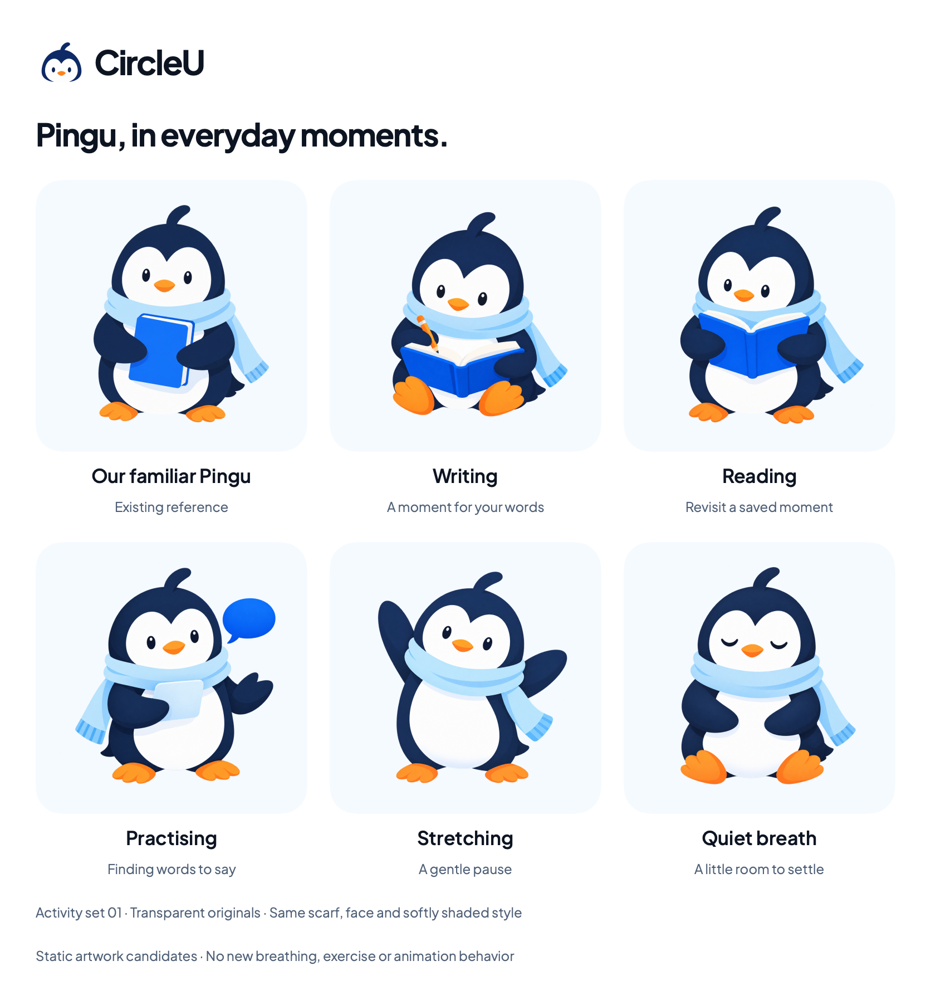

# Pingu activity artwork — set 01

24 October 2026. The owner requested Pingu doing more things and asked about app animation. Five new transparent illustrations extend the accepted character, with the existing avatar included as a comparison. These are review candidates and static artwork, not animation frames or new app features.

## Stored originals

All five files live in [BrandArtwork/Activities01](../../../Prototypes/CircleUVisualPrototype/Sources/CircleUVisualPrototype/Resources/BrandArtwork/Activities01). Each is a separate 1254 × 1254 RGBA PNG with genuine transparency. Total original size is 4,364,227 bytes. Created using the built-in image-generation tool from the existing `BrandAvatar.png` reference and copied without pixel editing. [Exact prompts, relative reference path and file hashes](pingu-activities-01-prompts.json) are retained. Existing artwork remains unchanged.

| File | Activity and proposed use |
| --- | --- |
| [PinguWritingV1.png](../../../Prototypes/CircleUVisualPrototype/Sources/CircleUVisualPrototype/Resources/BrandArtwork/Activities01/PinguWritingV1.png) | Writing in an open journal; possible Journal introduction |
| [PinguReadingV1.png](../../../Prototypes/CircleUVisualPrototype/Sources/CircleUVisualPrototype/Resources/BrandArtwork/Activities01/PinguReadingV1.png) | Reading a saved moment; possible retrieval introduction |
| [PinguPractisingV1.png](../../../Prototypes/CircleUVisualPrototype/Sources/CircleUVisualPrototype/Resources/BrandArtwork/Activities01/PinguPractisingV1.png) | Rehearsing from a cue card; possible Practice introduction, never a sending state |
| [PinguStretchingV1.png](../../../Prototypes/CircleUVisualPrototype/Sources/CircleUVisualPrototype/Resources/BrandArtwork/Activities01/PinguStretchingV1.png) | Gentle stretch; optional future illustration placement, no exercise feature |
| [PinguQuietBreathV1.png](../../../Prototypes/CircleUVisualPrototype/Sources/CircleUVisualPrototype/Resources/BrandArtwork/Activities01/PinguQuietBreathV1.png) | Quiet seated pause; optional future illustration placement, no guided breathing or health claim |

The blue scarf, navy/white face and body, crest, orange beak/feet and softly shaded style remain the identity reference. Reading/writing use an open book to distinguish them from the original closed-journal hug. Small props are not meant to be toolbar glyphs. Keep these larger accents modest on introductions or empty states, with aspect fit and transparent padding, away from the writing surface. Labels and appropriate accessibility treatment belong to integration.

## Animation recommendation

Use brief interface transitions and occasional finite Pingu movement, with a still writing experience and support for Reduce Motion. See the [motion proposal](../motion-guideline.md) for placements, source findings in the existing mascot component, reduced-motion alternatives and a proposed small demo. No animation implementation is authorized by this recommendation, and no animation was added in this task.

These PNGs are not a rig or aligned sequence. A true blink, wave or writing motion needs separately authored layers or consistent frames; moving the entire picture cannot animate its eyes or pencil independently. Preserve these originals as still fallbacks.

## Evidence

The standalone [SwiftUI activity catalog](../../../Prototypes/CircleUVisualPrototype/Sources/CircleUVisualPrototype/BrandPinguActivitiesPreview.swift) uses the existing artwork loader, actual Plus Jakarta Sans and source brand colors. A named Canvas preview is available, while the committed catalog is a macOS ImageRenderer export. Build, resource loading, transparency, dimensions and catalog layout are checked; no app/Simulator/device, live Canvas, Figma, accessibility runtime or motion behavior is verified. Artwork and placement choices remain for review.
