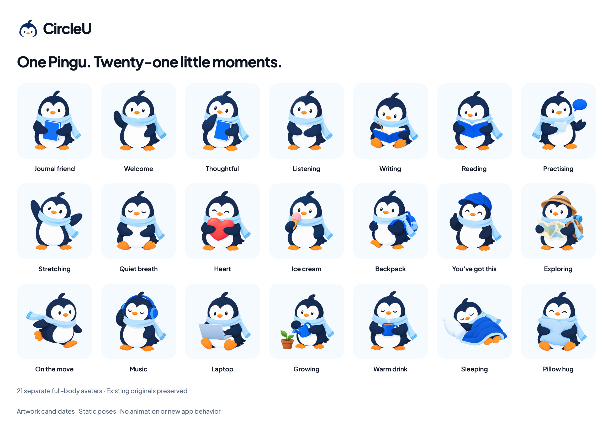

# Pingu collection — 21 avatars

24 October 2026. Owner supplied a sheet of many penguin activities and asked for a larger collection like it. Twelve new illustrations extend our nine existing full-body Pingu avatars, giving 21 separate poses. These are artwork candidates for review, not a new avatar picker, rewards system, activity feature or animation.

[View the 12 additions at a larger size](../swiftui-previews/brand-pingu-collection-12-new.png).

## Stored assets and reference

The new originals are stored in [BrandArtwork/Collection01](../../../Prototypes/CircleUVisualPrototype/Sources/CircleUVisualPrototype/Resources/BrandArtwork/Collection01). Each is a separate 1254 × 1254 RGBA PNG with real transparency. Total size of these twelve files: 10,519,704 bytes. Generated with the built-in image-generation tool and copied without pixel editing.

The [owner-supplied activity sheet](references/pingu-activity-sheet-owner.jpg) informed activities, props and variety. The existing [BrandAvatar.png](../../../Prototypes/CircleUVisualPrototype/Sources/CircleUVisualPrototype/Resources/BrandArtwork/BrandAvatar.png) remained the character/style reference: navy body, white face, blue scarf, orange details and softly shaded treatment. The sheet was not sliced into app assets. [Exact prompts, reference roles, dimensions, alpha-content bounds and SHA-256 hashes](pingu-collection-01-prompts.json) document the set.

| New file | Pose |
| --- | --- |
| [PinguHeartV1.png](../../../Prototypes/CircleUVisualPrototype/Sources/CircleUVisualPrototype/Resources/BrandArtwork/Collection01/PinguHeartV1.png) | Heart — Holding a heart |
| [PinguIceCreamV1.png](../../../Prototypes/CircleUVisualPrototype/Sources/CircleUVisualPrototype/Resources/BrandArtwork/Collection01/PinguIceCreamV1.png) | Ice cream — Enjoying a little treat |
| [PinguBackpackV1.png](../../../Prototypes/CircleUVisualPrototype/Sources/CircleUVisualPrototype/Resources/BrandArtwork/Collection01/PinguBackpackV1.png) | Backpack — Ready for the day |
| [PinguThumbsUpV1.png](../../../Prototypes/CircleUVisualPrototype/Sources/CircleUVisualPrototype/Resources/BrandArtwork/Collection01/PinguThumbsUpV1.png) | You’ve got this — A friendly gesture |
| [PinguExplorerV1.png](../../../Prototypes/CircleUVisualPrototype/Sources/CircleUVisualPrototype/Resources/BrandArtwork/Collection01/PinguExplorerV1.png) | Exploring — Curious about the next turn |
| [PinguRunningV1.png](../../../Prototypes/CircleUVisualPrototype/Sources/CircleUVisualPrototype/Resources/BrandArtwork/Collection01/PinguRunningV1.png) | On the move — A playful little dash |
| [PinguMusicV1.png](../../../Prototypes/CircleUVisualPrototype/Sources/CircleUVisualPrototype/Resources/BrandArtwork/Collection01/PinguMusicV1.png) | Music — Listening to a favourite song |
| [PinguLaptopV1.png](../../../Prototypes/CircleUVisualPrototype/Sources/CircleUVisualPrototype/Resources/BrandArtwork/Collection01/PinguLaptopV1.png) | Laptop — A focused little moment |
| [PinguGardeningV1.png](../../../Prototypes/CircleUVisualPrototype/Sources/CircleUVisualPrototype/Resources/BrandArtwork/Collection01/PinguGardeningV1.png) | Growing — Caring for something small |
| [PinguWarmDrinkV1.png](../../../Prototypes/CircleUVisualPrototype/Sources/CircleUVisualPrototype/Resources/BrandArtwork/Collection01/PinguWarmDrinkV1.png) | Warm drink — Taking a cosy pause |
| [PinguSleepingV1.png](../../../Prototypes/CircleUVisualPrototype/Sources/CircleUVisualPrototype/Resources/BrandArtwork/Collection01/PinguSleepingV1.png) | Sleeping — Resting for a while |
| [PinguPillowHugV1.png](../../../Prototypes/CircleUVisualPrototype/Sources/CircleUVisualPrototype/Resources/BrandArtwork/Collection01/PinguPillowHugV1.png) | Pillow hug — A moment of comfort |

## Existing nine retained in the full sheet

The original journal-holding avatar, Welcome, Thoughtful, Listening, Writing, Reading, Practising, Stretching and Quiet breath remain at their existing paths. See the [first expansion](asset-library.md) and [activity set](pingu-activities.md) for individual files and provenance. Logo/head marks and illustrated icons are excluded from the 21-avatar count.

## Usage and next review

- These are a reusable illustration collection. Choose a few appropriate placements; the app does not need all 21 on one screen. Keep editors and the calendar header calm.
- Use friendly activities contextually. Heart, thumbs-up and treat poses are not automatic approval, achievement or rewards. Laptop/music/gardening/sleeping illustrations do not create corresponding app features.
- Pink, green and tan appear as prop colors. Primary UI palette, font, logo and color tokens stay unchanged.
- Keep originals with transparent margins, preserve aspect ratio and avoid cropping props. Optical coverage varies by pose; Sleeping is naturally wider. These are raster review assets, not normalized vector masters or small-size control icons.
- Separate poses are not aligned animation frames or layered rigs. Follow the [motion proposal](../motion-guideline.md) before producing animation; none is added here.

The standalone [collection preview](../../../Prototypes/CircleUVisualPrototype/Sources/CircleUVisualPrototype/BrandPinguCollectionPreview.swift) provides named all-21 and new-12 Canvas specimens. Committed sheets are static macOS ImageRenderer exports using actual Plus Jakarta Sans and the existing brand colors/artwork loader. Build/resource/transparency/layout checks are recorded in the agent log. App, live Canvas, Figma, Simulator/device, animation, VoiceOver and production integration are not validated by these sheets.
