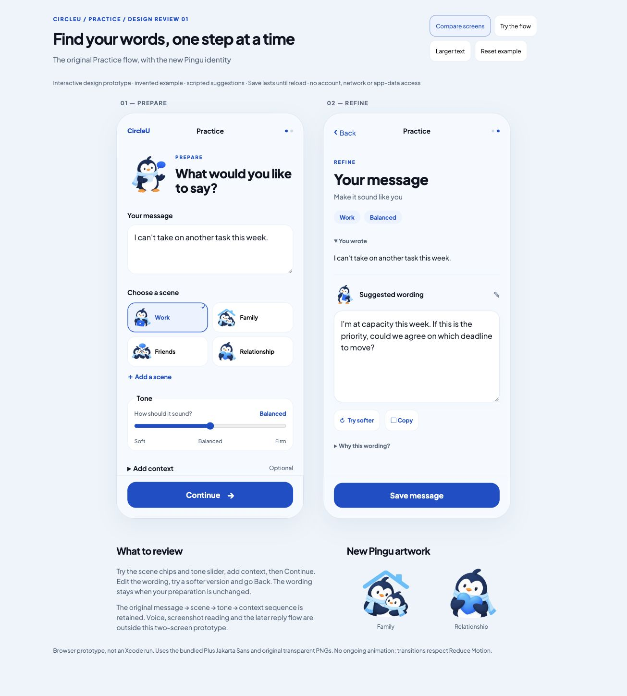

# Practice flow — branded review 01

27 October 2026. Owner explicitly approved prototyping Prepare and Refine with the original Practice flow, new branding and additional Pingu artwork. This is an isolated browser prototype, not a production SwiftUI change.

- [Open prototype source](../../../Prototypes/CircleUVisualPrototype/PracticeFlowReview/index.html)
- Local review: http://127.0.0.1:55988/PracticeFlowReview/
- [Original flow comparison](../practice-original-flow-review-2026-10-27.md)
- [New PNGs, exact prompts, reference and hashes](../../../Prototypes/CircleUVisualPrototype/Sources/CircleUVisualPrototype/Resources/BrandArtwork/PracticeFlow01/provenance.json)

## Preserved and refined

Prepare retains message → scene → tone → optional situation/context → Continue. Refine retains original words, suggested wording, softer alternative and Copy. The guest direction contributes editable wording and an explicit Save. The tone slider remains, with three positions labelled Soft / Balanced / Firm; the middle name is a prototype recommendation resolving the original Diplomatic/Direct mismatch.

Scene coverage remains Work, Family, Friends, Relationship and custom; wording shortens the original Workplace/Friendship/Romantic labels. A single primary action anchors each screen. Original content width/spacing and section sequence guide the composition. Plus Jakarta Sans is loaded from the bundled font. Blue/ice/ink tokens, compact Pingu illustrations and quieter white writing surfaces provide the new brand treatment. This specimen does not certify native safe areas or replicate every original dimension.

## Artwork

Two new separate 1254 × 1254 RGBA transparent originals: PinguFamilyTagV1 (two penguins under a roof) and PinguRelationshipTagV1 (Pingu holding a blue heart). Built-in image generation used PinguThoughtfulV1 as the style/character reference; copied unchanged with hashes and exact prompts. Existing Work, Friends, Practising and Thoughtful artwork is reused. PNG cutouts retain generated edge softness; these are review masters, not vector or animation assets.

## Review behaviour

- Compare screens shows both phone specimens. Try the flow shows one at a time; Continue moves to Refine and Back returns to Prepare.
- Message, chosen scene, tone and context carry through. Custom scenes require a name. No text truncation on message input.
- Unchanged preparation preserves edited wording. Changed preparation asks before replacing manually edited wording.
- Try softer has one-step Undo. Typing after a replacement clears Undo so it cannot discard subsequent edits.
- Empty wording disables Save, Copy and Try softer. Save stores only temporary JavaScript state; feedback says Saved in this preview. Reload/reset clears everything. Copy uses the browser clipboard with a manual-selection fallback.
- The invented Work example has scripted soft/balanced/firm variants. Arbitrary input is preserved verbatim, with a simple soft opening; context is displayed but is not interpreted. There is no AI or scene-aware inference for arbitrary text.
- Larger text is a browser layout stress mode, not iOS Dynamic Type. Bodies scroll independently of their fixed action footers. Reduce Motion disables CSS transitions.

Voice input, screenshot extraction, optional follow-up reply coaching, durable storage, loading/network errors and production migration are outside these two screens. They have no misleading active buttons here. The app, Firebase and legacy data are unchanged.

## Checks

Browser walkthrough: Family selection/custom Study group, tone Firm, context carry-through, Continue, editing, Try softer/Undo, temporary Save feedback, Back/Continue retaining edits, empty wording disabled actions and larger-text scrolling to fixed Save. Inspected both screens and full-page comparison. Asset dimensions/alpha/hashes and local links checked; JavaScript syntax and git whitespace checked. Copy result and final empty-state checks are recorded in the dated log.

Not checked: physical phone, native keyboard/VoiceOver, all browser widths, replacement-confirmation branches, real clipboard-denied path, Xcode build or UI tests. No Swift was changed in this pass.
