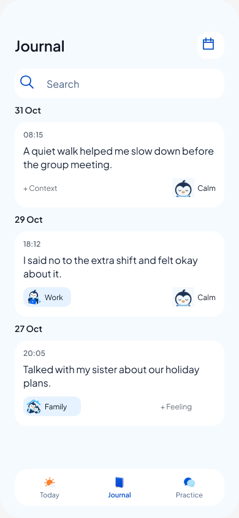
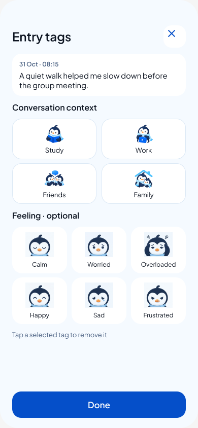

# Journal emotions — Figma review 14

31 October 2026. The owner requested expressive emotion artwork, a clear distinction from conversation types, and a cleaner Journal history, using Figma AI credits. The product brief was amended before editing the prototype.

[Open Journal prototype](https://www.figma.com/proto/rfknpmLIXsOxA7fHUQQMtR/CircleU-Design--from-Claude-canvas-?node-id=74-210&starting-point-node-id=74%3A3&scaling=scale-down&content-scaling=fixed) · [Editable page](https://www.figma.com/design/rfknpmLIXsOxA7fHUQQMtR/CircleU-Design--from-Claude-canvas-?node-id=74-2)

## Design

- Conversation context: existing blue activity chips for Study, Work, Friends and Family, on the left of each entry.
- Feeling: a Pingu face and a short label on the right. Calm, Worried and Overloaded are joined by Happy, Sad and Frustrated as review candidates. No automatic classification.
- Shared date headings; small time inside each card; writing remains the dominant content. Plus Jakarta Sans and the existing palette remain. History body 16 px, date groups 14 px, metadata 12 px. Controls retain 44 px targets.
- Context and feeling can be independently unset. The picker supports select, replace, deselect, Done and close without saving.

The connected review 13 page evolved in place to **CircleU • connected review 14** (`74:2`) so its navigation IDs stay intact. Older review 09–12 pages and historical review 13 screenshots remain. Twenty-five entry-tag rows and four pickers were updated; no native Swift code changed.

## Artwork and credits

[EmotionPortraits01](../../../Prototypes/CircleUVisualPrototype/Sources/CircleUVisualPrototype/Resources/BrandArtwork/EmotionPortraits01) contains the original 1264 × 848 JPEG sheet, six individual 360 × 320 PNGs, generation prompt, Figma component IDs and SHA-256 hashes. One Figma `generate_image` operation used `gemini-3.1-flash-lite-image`. The generated sheet included text labels despite the prompt; the master stays unchanged, while Figma crop fills exclude that text and the UI uses editable labels. Portrait backgrounds are opaque pale blue.

The refreshed Figma account balance is **2,974 credits**, down 6 from the previously verified 2,980. The account shows a 3,000-credit Education allowance, resetting Nov 1. No Weave credits were used. This is an observed balance difference, not a general price guarantee.

## Verification

- Inspected Figma exports of Journal and the six-feeling picker at their natural 390 × 844 size. Done and all six choices fit the screen.
- Player: selected Friends + Happy and saved; each appeared in its intended position without changing entry text.
- Player: chose Frustrated then closed; Happy remained saved.
- Player: deselected Happy and saved; + Feeling returned while Friends remained.
- Player: restored Happy, switched to Practice and back; Friends + Happy remained on the correct entry.
- Caught a Happy label wrapping: the width estimate allocated 36.5 px, but the actual font needed 39 px. Applied intrinsic text sizing across feeling labels and rechecked the saved player state.
- Assets and JSON checked locally; scoped whitespace check passed. No Xcode build, native tests, physical-device, Dynamic Type or VoiceOver check was run for this Figma-only change. Calendar/search branches and every emotion combination were not replayed this turn.

Prototype variables last for the player session and reset on restart/reload. Typed input, voice, AI feedback and durable storage retain the bounded simulation limitations documented in [review 13](../figma-connected-review-13/README.md). No new cloud or native persistence behavior is approved by this review.

## Handoff

Review emotion readability and the card hierarchy with the owner before native integration. `state-map.json` is the current Figma variable/component map. `refine-journal.js` records the one-time mutation against review 13; do not rerun it on review 14. `fit-labels.js` records the subsequent intrinsic-width fix. Native work would need schema, export and accessibility criteria before implementation.
