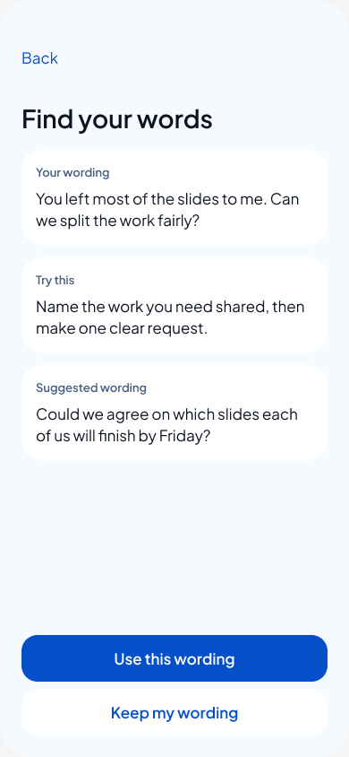
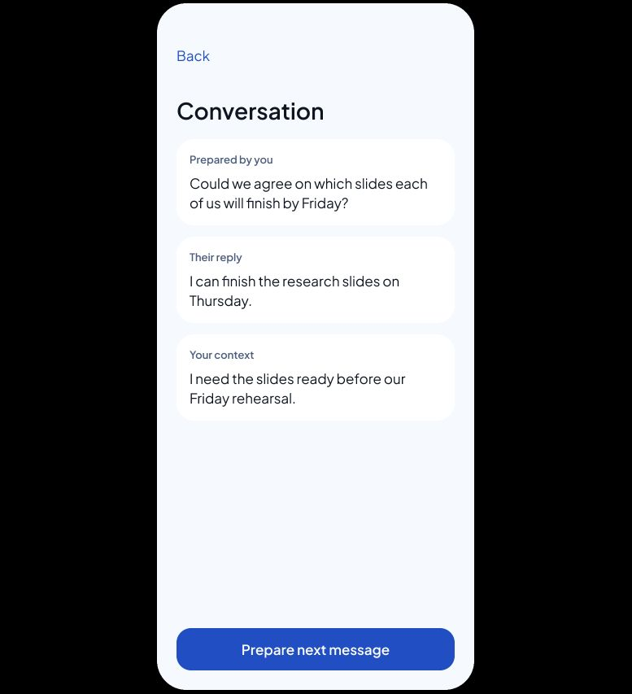

# Figma Practice flow review 09

31 October 2026. Owner requested flow/prototype work in Figma after the artwork-credit trial. This first pass translates the approved message-first direction into a connected fixed-scenario walkthrough. It is not full app parity or a native implementation.

- [Play Practice](https://www.figma.com/proto/rfknpmLIXsOxA7fHUQQMtR/CircleU-Design--from-Claude-canvas-?node-id=39-7&starting-point-node-id=39%3A7)
- [Edit the review page](https://www.figma.com/design/rfknpmLIXsOxA7fHUQQMtR/CircleU-Design--from-Claude-canvas-?node-id=39-7)
- [Optional guidance](https://www.figma.com/proto/rfknpmLIXsOxA7fHUQQMtR/CircleU-Design--from-Claude-canvas-?node-id=39-44&starting-point-node-id=39%3A44)
- [Failure recovery](https://www.figma.com/proto/rfknpmLIXsOxA7fHUQQMtR/CircleU-Design--from-Claude-canvas-?node-id=39-380&starting-point-node-id=39%3A380)

## What changed

Existing Practice frames had no reactions or starting point. The prior screens remain untouched on Screens and options. A new Practice • review 09 page contains 28 state frames, 71 navigation reactions, two local action components and 41 instances. Branch copies preserve the original, suggested or edited message when adding a reply; they are state variants, not extra required steps.

Main route: Practice → blank wording → tap the field to load the invented example → Review wording → selected-text confirmation → timed feedback → Use wording → Save → add their reply/context → conversation → empty next-message handoff. Optional intent guidance does not invent original words. Manual Save without feedback, edit/discard, Undo, cancellation and failure-return destinations are represented. Failure recovery is a separate prototype start, not a fake user-facing failure button.

Reuse: existing Pingu image fill, ice/blue surface colours, 390 × 844 phone size, Plus Jakarta Sans and concise content. No added libraries or applicable Code Connect components were found. No full-UI image was imported; content is editable text and frames. [Build source](build-figma.js) includes the heading-height and draft-departure corrections; it refuses to duplicate an existing named page. IDs in [validation.json](validation.json) refer to the live file, not IDs a future rerun would create.

## Verification and limitations

- Structural read: 28 screens, 71 valid destinations, no screen/content overflow, only Plus Jakarta Sans text. 203 text layers and 41 instances. Source image fills only on three small Pingu illustrations.
- Browser walkthrough: Practice start → blank → populated → confirmation → timed loading → feedback → Use → Save → add reply → attributed conversation. Multiline heading clipping was found visually and fixed using text HUG height; Prepare and Refine rechecked.
- Undo, guidance, error and discard links were inspected structurally; those branches have not received a full browser interaction walkthrough. No VoiceOver, Dynamic Type, phone, keyboard or network validation.
- All text, edits, saving and replies are preset Figma states. No live AI, microphone, clipboard, account recovery or storage. The page has an external review-scope note. This prototype must not be presented as the shipping app.
- Still pending: free-form typing, Copy, voice states, user-selected optional context/tone, next-reply refinement, full departure safeguards on every branch, Today/Journal/onboarding navigation and user testing. Existing browser/native specimens remain the references for those capabilities.
- No Figma credit balance or debit was returned by the design-edit tools. No additional paid Figma image generation was requested.

Requirements: M04/M09; proposed story P9. [Approved message-first design](../../superpowers/specs/2026-10-30-message-first-practice-design.md). This adds prototype evidence only and does not change product scope or native test claims.

