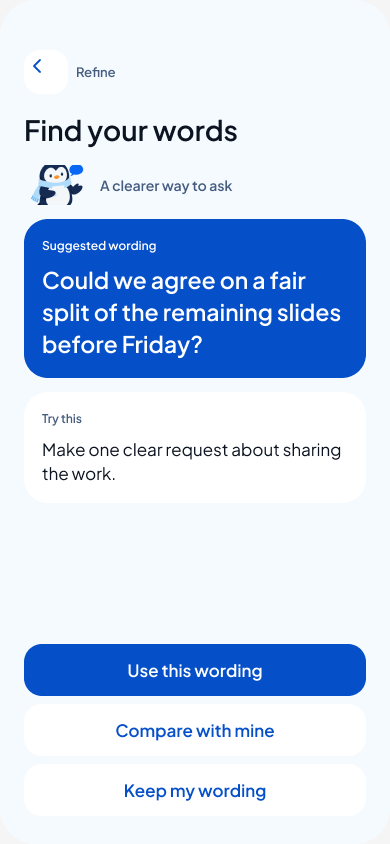
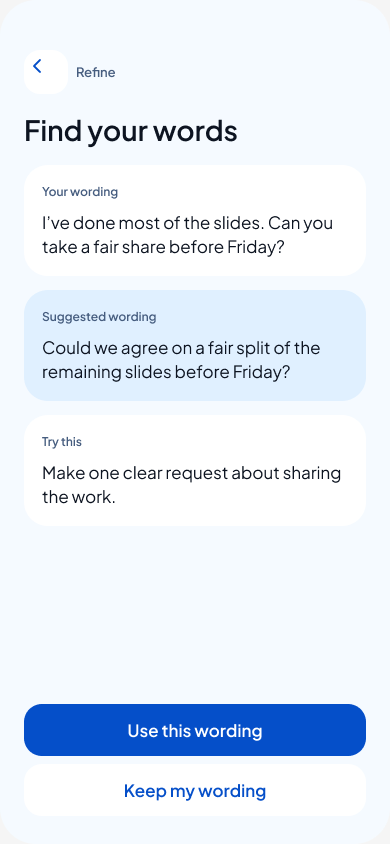
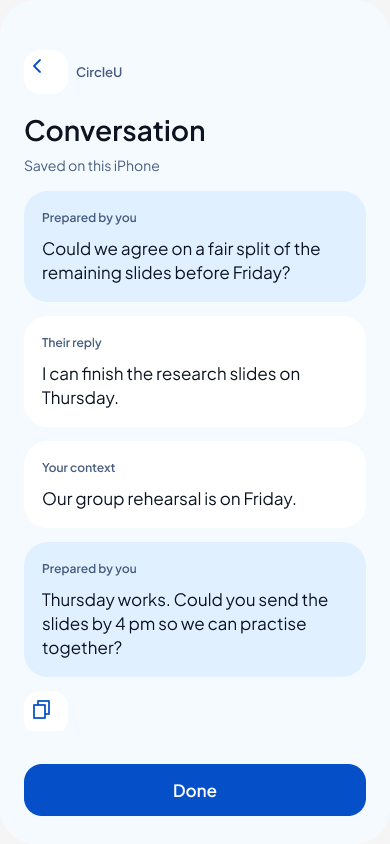

# Practice review 10

31 October 2026. Owner approved polishing Prepare → Refine → Conversation, adding missing voice/Copy/reply/recovery states and comparing two Refine layouts. This is a Figma design study, not native implementation or live AI activation. Requirements: M04/M09, P6–P9. Product intent remains the [approved message-first direction](../../superpowers/specs/2026-10-30-message-first-practice-design.md).

## Review links

**Owner selection — 31 October 2026:** Option A is the approved visual direction for Refine: Pingu guidance, suggestion-first blue card and one primary Use action. It is already the main feedback destination. B remains available through Compare with mine as an optional comparison. This selects the prototype appearance; it does not approve native implementation or live AI.

- [Play the complete scenario](https://www.figma.com/proto/rfknpmLIXsOxA7fHUQQMtR/CircleU-Design--from-Claude-canvas-?node-id=51-45&starting-point-node-id=51%3A45)
- [Refine A: suggested wording first](https://www.figma.com/proto/rfknpmLIXsOxA7fHUQQMtR/CircleU-Design--from-Claude-canvas-?node-id=51-164&starting-point-node-id=51%3A164)
- [Refine B: original and suggestion together](https://www.figma.com/proto/rfknpmLIXsOxA7fHUQQMtR/CircleU-Design--from-Claude-canvas-?node-id=51-189&starting-point-node-id=51%3A189)
- [Edit the new page](https://www.figma.com/design/rfknpmLIXsOxA7fHUQQMtR/CircleU-Design--from-Claude-canvas-?node-id=51-164)

Tap the wording or reply card to populate the invented scenario. Use the prototype flow selector for voice and failure branches. UI text remains concise; the simulation explanation sits outside the phone frames on the Figma page.

## What changed

- Separate **Practice • review 10** page. Original screens and review 09 preserved.
- A emphasises one suggestion with Pingu and a blue card; B keeps both versions visible in quieter stacked cards. A has a Compare with mine link to B. These are alternatives for review, not two mandatory product screens.
- Prepare → explicit online text confirmation → feedback → Use → Copy or Save → add their reply/context → next draft → confirmation → feedback → Use → Save. Done returns to a Practice state that reopens the latest conversation.
- Record → Stop → transcript → optional correction → Use text. Permission denied and transcription failure offer typing. Recording/cancel/discard are explicit preset states.
- Separate unsaved/saved Copy confirmations; Copy, save and feedback failures; empty validation; draft retention/discard; manual saving without feedback; intent-only guidance.
- Existing Plus Jakarta Sans, Pingu image fill and brand surfaces; editable rounded outline controls with 44 × 44 targets and named layers. Source buttons remain component instances. No external library matched the missing CircleU icons, so local editable vector components were created.
- Navigation top remains y=50; action-area bottom remains y=816 within 390 × 844 frames. Content has a separate vertical-scroll viewport. Primary button height can shift when secondary controls are present; the header and bottom edge remain stable.

## Verification

[Final structural report](validation.json): 56 state frames, 155 valid connections, 374 text layers, 148 component instances, only Plus Jakarta Sans. No invalid destinations, top-level overflow, heading/supporting-line length violations or banned/overlong UI strings. Frames represent branch states, not 56 steps in the main journey.

Browser click-through covered Practice → voice → Stop → transcript → Use text → Prepare → confirmation → timed feedback → A → Compare/B → Use → Copy confirmation → Save → add reply → conversation → next draft → confirmation → timed feedback → Use → Save → Done → reopen latest conversation. Main state outcome saved in [walkthrough.jpg](walkthrough.jpg). A, B and final conversation exports were visually inspected.

Feedback failure → Try again was also clicked and returned to the same selected-text confirmation. All remaining destinations were structurally checked; this is not an exhaustive manual branch test. Figma has no microphone, clipboard, storage, actual network request or free-form text editing in this study. Displayed success states are preset outcomes. No claim of native VoiceOver, Dynamic Type, keyboard, device or persistence validation; no app build or unit/UI tests run because no app code changed.

Bounded review limits: optional tone/context selection before the first review, voice append to an existing draft, unlimited reply turns, and complete history persistence across every alternative branch remain outside this fixed scenario. Manual-save alternative branches end at their correctly attributed saved message. Today/Journal/onboarding remain separate work. Freeform prototype input would require a runnable implementation rather than these Design-frame links.

## Files and credit accounting

[build-figma.js](build-figma.js) creates the page, refusing a duplicate name. [finish-figma.js](finish-figma.js) records the one-time, live-ID finishing patch; do not rerun it blindly. IDs in validation belong to the current Figma document.

The editor reported 3,000 Figma AI credits with a November 1 reset before this work. This pass used direct Figma editing, with no paid image-generation or Figma AI prompt submitted. The MCP did not return a credit debit. Weave was not used. The credit balance and plan access are independent of the prototype's simulated AI feature.

