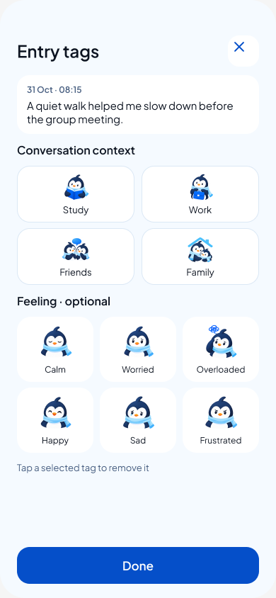

# Transparent Pingu artwork — review 15

31 October 2026. Owner chose Codex-generated artwork for brand consistency, real transparent PNG icons without blue background squares, and Figma credits for prototype assistance only.

[Open prototype](https://www.figma.com/proto/rfknpmLIXsOxA7fHUQQMtR/CircleU-Design--from-Claude-canvas-?node-id=74-210&starting-point-node-id=74%3A3&scaling=scale-down&content-scaling=fixed)

The existing page 74:2 is now **CircleU • connected review 15**. Its six shared emotion components were updated in place with the Codex-generated [EmotionPortraits02](../../../Prototypes/CircleUVisualPrototype/Sources/CircleUVisualPrototype/Resources/BrandArtwork/EmotionPortraits02) PNGs, propagating to the Journal rows and all four pickers. The opaque Figma master is hidden and marked archival. Original source files and historical review screenshots are preserved.

The existing Codex-generated activity/context illustrations, labels, spacing, font, blue context-chip treatment and prototype reactions remain. The correction removes baked artwork backgrounds, not intentional UI surfaces. No Figma AI generation or credit-consuming prototype operation was invoked this turn: uploads and component replacements were sufficient. No credit balance was remeasured.

## Verification

- Six separate image outputs inspected; alpha metadata verifies RGBA with transparent exterior and opaque character pixels.
- All six uploads succeeded against the existing component image nodes, using FIT.
- Journal and picker Figma screenshots inspected at 390 × 844: no square image backgrounds, all six choices and Done fit, labels remain editable.
- No behavior/reaction edits. Review 14 save/cancel/deselect/tab-return evidence remains historical; this turn is asset-only.
- JSON, local links and scoped whitespace checked. No native build, unit/UI suite or physical-device check: no Swift or native asset catalog changed. Dark-surface and large-format optical cleanup remain future asset qualification.

Current variable and component IDs remain in [review 14 state-map](../figma-journal-emotions-review-14/state-map.json). User stories J7.2 and J7.8 retain their behavior; this correction only changes their illustration source and transparency.
