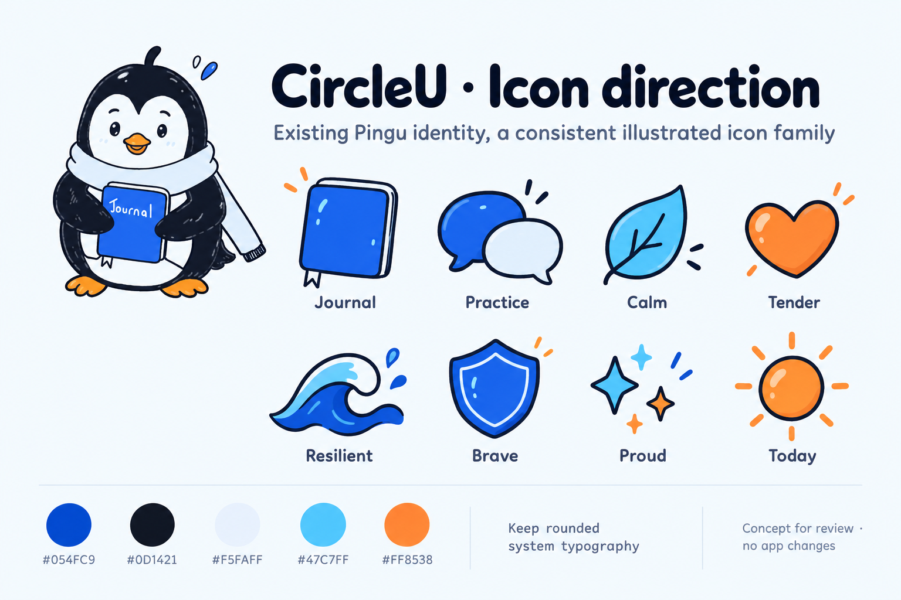

# Pingu icon direction — concept 01

Latest direction: the owner prefers illustrated Pingu-inspired artwork but wants a modern, non-sketchy redesign of logo, avatar and icons. See the [branding discussion draft](../branding-guideline.md). This earlier sketch-like board is a reference, not the selected final style.

Status: discussion concept, 23 October 2026. Owner wants existing Pingu assets reused, generic emoji replaced with consistent artwork, and discussion before design/palette/font changes. No production assets or app code were changed.

Follow-up: [rounded outline alternative with the original logo and real native typography](outline-review.md). Both concepts remain available for comparison; no final style has been selected.

## Recommended direction

Reuse original Pingu artwork on welcome/empty/Today surfaces. Add a small family of illustrated accents for content and feeling labels. Keep familiar native symbols for back, edit, copy, delete, microphone and other functional controls. Keep labels alongside unfamiliar icons.

The board explores Journal (book), Practice (conversation bubbles), Calm (leaf), Tender (heart), Resilient (wave), Brave (shield), Proud (sparkles) and Today (sun). The emotion names reflect existing `PinguEmotionMeta` mappings; this does not approve a fixed emotional taxonomy or revive rewards. This is one review board, not eight extracted or production-ready assets.

| Design element | Proposal |
| --- | --- |
| Typography | Retain native rounded system typography; use readable regular body text and restrained bold headings. No new font dependency. |
| Palette | Retain existing light-mode PinguBlue #054FC9, PinguInk #0D1421, PinguIce #F5FAFF and PinguSky #47C7FF. Warm orange approximately #FF8538 follows the existing asset's decimal color definition. |
| Illustration | Navy contours, simple rounded forms, blue/ice fills, occasional orange accents. Simplify shading/details before testing small sizes. |
| Surfaces | Calm backgrounds and clear text cards; use existing glass treatments selectively after contrast review. |

The generated swatches are illustrative, not authoritative color samples. Asset-catalog values remain the source of truth; dark-mode equivalents already exist for several colors and need a separate visual check. The board contains a generated rendition of the reference mascot; production should reuse the original `PinguMascot` file, not extract that rendition.

Two reasonable treatments to discuss: illustrated accents (shown, recommended for matching Pingu), or simpler monochrome rounded outlines (quieter and easier at very small sizes). Avoid mixing unrelated emoji styles with the new illustration family.

## Scope and next steps

“Favicon” was interpreted as small in-app icons because the request referred to emoji in the app. A browser favicon and the iOS app icon are separate deliverables; neither was replaced here.

After style feedback: create separate transparent icon assets, validate at intended sizes (especially 24–32 points), preview light/dark contexts, and use the agreed set in the isolated prototype first. Existing user-authored emoji/data and deferred circles/rewards are outside this visual replacement pass.

## Generation provenance

- Built-in image-generation tool; reference: `Circleu/Assets.xcassets/PinguMascot.imageset/pingu-mascot.png`.
- Source image preserved. Concept saved non-destructively as `pingu-icon-concept-v1.png`.
- [Full generation prompt](prompt.txt).
- Visually inspected: eight concepts and labels present, coherent blue/ice/orange family, no new app implementation. Final icon geometry, native typography and tiny-size legibility remain unverified.
