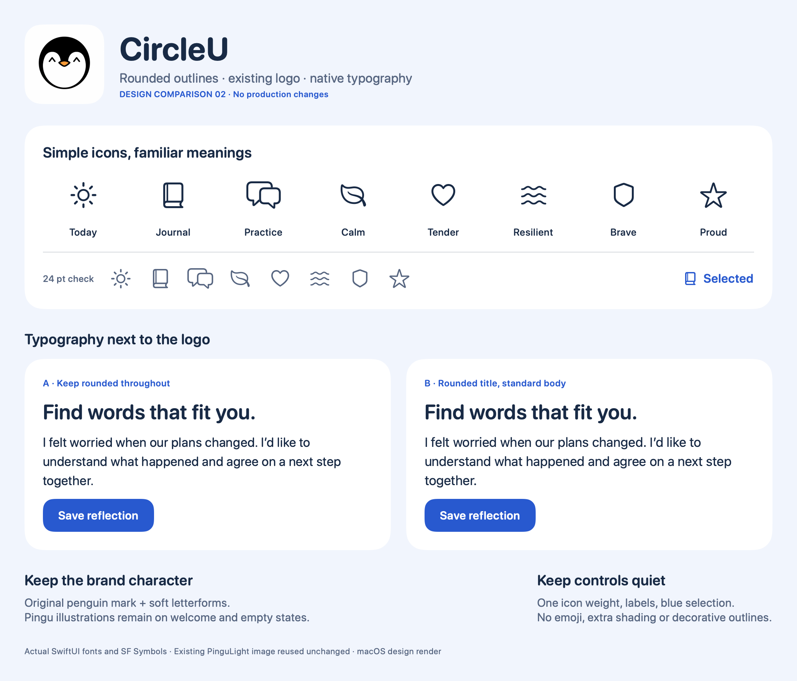

# Rounded outline icons, logo and typography

Follow-up: the owner chose to pursue modern Pingu-inspired illustrated branding, including logo/avatar changes. See the [branding discussion draft](../branding-guideline.md). The recommendations below remain a dated comparison, not the current selected direction.

23 October 2026. Owner requested a simpler outline alternative and a logo/font compatibility check. This is an isolated design comparison, not an approved production redesign.

## Findings and recommendation

The existing iOS app icon (`PinguLight.png`) is a simplified penguin face with rounded contours, closed smiling eyes and a warm beak accent. It can remain the compact brand mark while the existing full Pingu mascot remains the larger illustration. They share the penguin identity without needing identical detail at both sizes. No logo replacement is recommended in this pass.

The app already uses native rounded system fonts in `PinguFont` and the onboarding/glass components. The soft letterforms complement the mark's curved silhouette. The comparison header is a proposed text lockup using that existing font family; no dedicated wordmark/font asset was found in the repository search.

**Recommend option A:** keep rounded system typography throughout, semibold headings and regular reading text. The board uses 27-point sample headings and 17-point body text; existing `PinguFont.body` is 14-point medium. Increasing reading text and reducing weight is proposed for review, not applied to the production tokens. Final implementation should use text styles that respond to Dynamic Type and be checked with real content.

**Option B:** rounded headings with default system body text is a valid quieter alternative. Both use native fonts; no external font package is needed. This visual comparison is not a reading-speed or accessibility study.

## Icon proposal

The board uses actual SF Symbols at regular weight, displayed at 32 and 24 points. These are native symbol candidates, not newly authored proprietary icons or emoji. Existing use of SF Symbols in the app makes this a reuse path.

| Purpose | Proposed symbol |
| --- | --- |
| Today | `sun.max` |
| Journal | `book.closed` |
| Practice | `bubble.left.and.bubble.right` |
| Calm | `leaf` |
| Tender | `heart` |
| Resilient | `water.waves` |
| Brave | `shield` |
| Proud | `star` |

Use labels, one optical weight, and the existing accent for selection. The logo can be visually heavier than controls because it has a different role. Keep Pingu illustration for welcome/empty/Today moments. Emotion names/mappings remain existing sample labels, not an approved emotion classification. No circles/rewards are reintroduced.

The first render used filled `sparkles` for Proud; changed to an outline star to keep the simpler treatment consistent. Final 24-point row was visually inspected, but no physical-device or accessibility validation is implied.

## Brand inconsistencies to resolve later

- Website `docs/index.html` uses a “C” mark and `Circleu`; app/design references use the penguin and often `CircleU`. Recommend a consistent public name **CircleU**, with the existing penguin as the shared mark. Do not rename bundle IDs, project files or internal types merely to standardize display copy.
- Website CSS lists Inter first; Figma uses Inter as a documented fallback; native previews use system rounded. The website declaration alone does not prove which font a browser actually renders. Treat these as cross-surface consistency work, not evidence the native font is wrong.
- Keep current assets intact. Browser favicon, dark/tinted app-icon treatment and final icon asset export are separate tasks; this board does not change them.

## Implementation and verification

- Created `IconDirectionPreview.swift` in the existing isolated SwiftUI package; added a named Xcode preview and one PNG export.
- Copied the existing app icon unchanged into a preview-only image set; compared bytes with the original. No original source asset or production app code changed.
- Native SwiftUI renderer, not image generation: real system fonts/glyphs, existing logo pixels and current draft colors. This board retains Draft 02 palette values for a direct icon/type comparison rather than changing palette at the same time.
- Package build and render checked; no full app run, Firebase work or migration. Review A/B preference before applying typography to the prototype screens.
