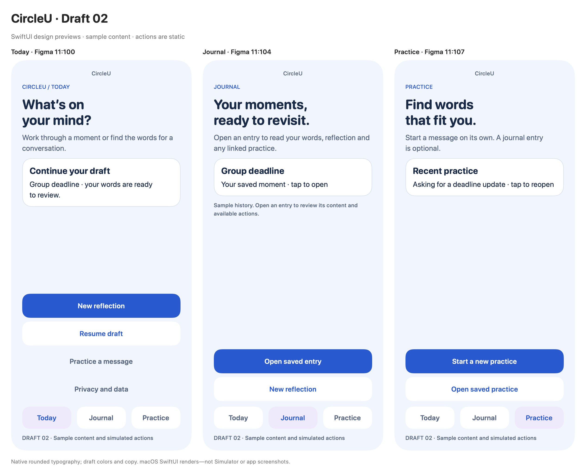
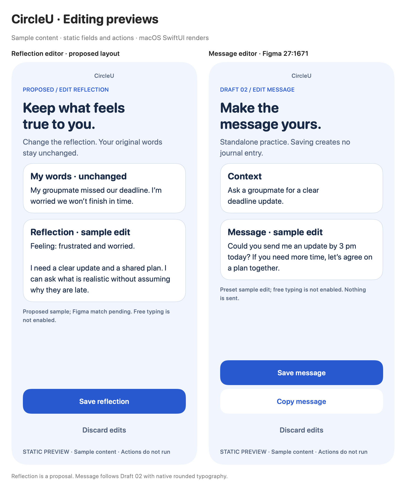

# Draft 02 SwiftUI design renders

Generated 23 October 2026 from the [standalone preview package](../../../Prototypes/CircleUVisualPrototype/README.md), using SwiftUI ImageRenderer on macOS at 2× scale. These are **static design renders with sample content**, not screenshots of the running app or Simulator. No real user data is included.

| Image | Point size | Pixel size | Figma source |
| --- | --- | --- | --- |
| [Today](today.png) | 390 × 844 | 780 × 1688 | [11:100](https://www.figma.com/design/RVLtfmIVcO8gNk5fam0Vjd?node-id=11-100) |
| [Journal](journal.png) | 390 × 844 | 780 × 1688 | [11:104](https://www.figma.com/design/RVLtfmIVcO8gNk5fam0Vjd?node-id=11-104) |
| [Practice](practice.png) | 390 × 844 | 780 × 1688 | [11:107](https://www.figma.com/design/RVLtfmIVcO8gNk5fam0Vjd?node-id=11-107) |
| [Compact-width Today](today-compact.png) | 320 × 844 | 640 × 1688 | Same Today content |
| [Gallery](gallery.png) | 1266 × 1029 | 2532 × 2058 | All three |
| [Reflection editor proposal](edit-reflection.png) | 390 × 844 | 780 × 1688 | Proposed from agreed flow; Figma verification pending |
| [Message editor](edit-message.png) | 390 × 844 | 780 × 1688 | [27:1671](https://www.figma.com/design/RVLtfmIVcO8gNk5fam0Vjd?node-id=27-1671) |
| [Editor comparison](editors.png) | 852 × 1029 | 1704 × 2058 | Both editors |

## Editing previews and Xcode

[Demo 05 — lighter copy and rounded icons](../brand-demo/lighter-icon-journeys.md) responds to the latest owner feedback with [reflection](brand-05-reflection-journey.png), [Practice](brand-05-practice-journey.png) and [linked-context](brand-05-linked-contexts.png) variants. Earlier renders remain comparison references.

[Brand demo 04 core journeys](../brand-demo/core-journeys.md) adds [reflection](brand-04-reflection-journey.png), [direct Practice](brand-04-practice-journey.png) and [original/changed linked context](brand-04-linked-contexts.png). The [two-entry calendar day](brand-03-journal-multiple.png) complements the prior saved/empty samples. [Walkthrough worksheet](../prototype-review-results.md): prepared, not run. All fields/actions remain static.

[Journal calendar — demo 03](../brand-demo/journal-calendar.md) shows [saved and empty selected dates](brand-03-calendar.png). Dates and entry dots are fixed October 2026 sample data; the calendar is not interactive.

[Brand demo 02](../brand-demo/flow-previews.md) carries the accepted identity into [all three hubs](brand-02-hubs.png) and [both editors](brand-02-editors.png), with a softer Practice icon. The new layouts are static visual proposals; the original Draft 02 renders below remain reference evidence.

The subsequent [brand demo 01](../brand-demo/README.md) explores a coordinated new Pingu logo, avatar and illustrated icons with actual Plus Jakarta Sans: [brand board](brand-demo.png) and [Today sample](brand-today.png). It is a separate visual proposal, not a change to the Draft 02 Figma frames or original renders.

The [outline icon/logo/type comparison](outline-icon-direction.png) uses original app-icon pixels and real native fonts/SF Symbols. See the [matching review](../icon-direction/outline-review.md) for the two typography options and proposed icon mapping.

The reflection layout is a labelled proposal from the agreed flow because the Figma connector reached its plan limit. The message editor's context and screenshot were retrieved successfully. Both reuse draft components and native typography, with static fields/actions and invented content. See the [hub review and asset recommendations](../preview-review-2026-10-23.md).

Xcode Canvas now works with the **CircleUVisualPrototype** library scheme and **My Mac** destination. [Captured message-editor Canvas](xcode-message-preview.jpg). The whole-package scheme produced an executable debug-library error; selecting the library scheme resolved it. This supersedes the earlier opening-timeout limitation.

Live Figma contexts/screenshots were read for all three source frames. Native rounded system fonts intentionally replace Figma's Inter fallback; the fake status-bar time is omitted. Cards, copy, colors and tab selection follow the draft. Actions and tabs are noninteractive visual labels. The Figma footer retains its original simulated-actions wording; in these SwiftUI boards actions are entirely static.

The initial renderer omitted ScrollView contents. Direct static layout resolved the missing cards/text; all three boards and the compact-width render were visually inspected afterward. This checks the declared fixed sizes only, not short-screen scrolling, Dynamic Type, VoiceOver, keyboard handling or iOS behavior.

Use the [interactive Figma prototype](https://www.figma.com/proto/RVLtfmIVcO8gNk5fam0Vjd?node-id=11-100&starting-point-node-id=11%3A100) for navigation and editing flows. Current design decisions remain in the [design reference](../README.md).
