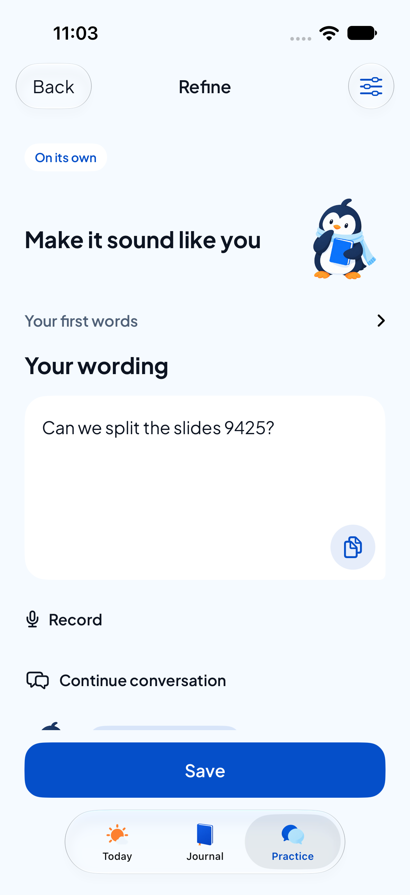
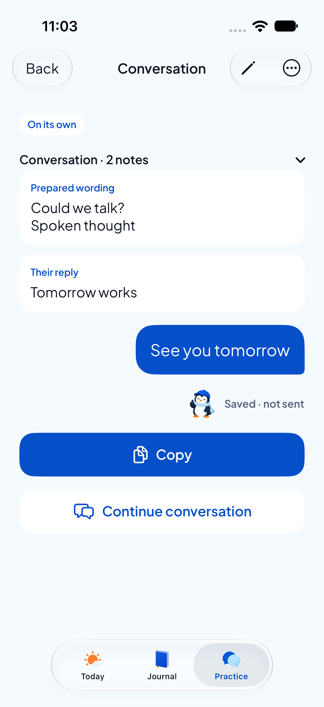

# Native Practice review — 27 October 2026

Working-tree implementation on `codex/app-upgrade-plan`, based on `9967a10`. User approved native implementation after reviewing PracticeFlowReview. Existing unrelated changes remain uncommitted.

## What to review

Open **CircleU Guest Test → Practice → Practice a message** on the iPhone.

1. Prepare: type your words, choose a Pingu scene and Soft / Balanced / Firm, optionally expand Situation and Goal. Continue.
2. Refine: edit, request optional suggestions, use/undo an option, copy or explicitly Save.
3. Continue conversation: paste Their reply and/or add More context. Continue keeps attributed history and opens a fresh wording draft. Save updates the same conversation; Copy never sends.
4. Record your words (also available for a reply or context): Record → Stop → review/edit → Use text. Existing text stays, with the transcript appended. Cancel changes nothing outside the sheet. No audio file is stored; on-device Speech is required.
5. Reopen the conversation, expand its history, and check Earlier wording / Their reply / Added context. Saved edits require Save; Back asks before discarding changes.

On phones without available Apple Intelligence, suggestions are labelled guided prompts. The fallback cannot understand the conversation semantically. It does not repeat someone else's words as yours or acknowledge a reply when only context was added. No new cloud AI route was enabled.

## Xcode

Project: `Circleu.xcodeproj` in the existing `guest-quality-fixes/CircleU` worktree. Select **CircleU Guest Review** and the physical iPhone. This new local review configuration compiles `DEBUG GUEST_JOURNAL_BUILD`; the standard Debug/Release routes are unchanged. It uses the private `CIRCLEU_REVIEW_BUNDLE_ID` setting in ignored `Config/Signing.xcconfig`. The checked-in example documents the setting. The shared review scheme has no archive action.

For this owner's already-installed Guest Test, the verified bundle is `com.tuannm3812.circleu.guesttest`. Signing was matched to its earlier signed build. Install updates in place; never uninstall to solve a signing problem.

Reproduce build:

```sh
DEVELOPER_DIR=/Applications/Xcode.app/Contents/Developer xcodebuild build \
  -project Circleu.xcodeproj -scheme 'CircleU Guest Review' \
  -destination 'generic/platform=iOS' -allowProvisioningUpdates
```

## Evidence

- Full unit suite: **266 passed, 1 skipped, 0 failed**; result `Test-Circleu-2026.10.27_11-06-55-+1100.xcresult`, in `/tmp/circleu-quality-derived/Logs/Test/`. Includes V4→V5 migration, reopen, stale revision, unreadable conversation, old draft decoding, export/search, context-only suggestions and voice state tests.
- First focused UI run: conversation/voice insertion/save/reopen, linked-entry deletion choices, keyboard-safe Save at standard and maximum accessibility text, and suggestion use/Undo passed. Copy/edit/discard failed because the test assumed the cursor stayed at the end after Prepare→Refine; corrected to assert persistence of the actual edited string. Final rerun recorded below when complete.
- Device build: `CircleU Guest Review` succeeded; installed in place on iPhone 11 Pro Max / iOS 26.6.1. Automatic launch refused because the phone was locked. Owner subsequently confirmed that Record → Stop → Use text produces and inserts the transcript on the physical phone. This is owner-reported evidence; preservation of all pre-existing records was not separately confirmed.
- Xcode UI verified: worktree source `GuestPracticeScreens.swift` open, **CircleU Guest Review**, destination **Tuan M. Nguyen**.
- Native screenshots below are unmodified iPhone 17 / iOS 27 simulator XCUITest captures, with invented text. Provenance/hashes in `provenance.json`.

Still unverified: other languages/model availability, permission recovery, recording interruption/cancellation on the phone, VoiceOver speech, every device/orientation, Release/TestFlight, cloud recovery, or semantic quality of Apple Intelligence suggestions. Full UI suite must pass before merge; focused UI checks do not replace it.




## Design and storage decisions

V5 adds optional encoded conversation data to a practice record. V1–V4 schemas are retained, with a lightweight V4→V5 stage; old records keep IDs, revisions, wording and journal links. Conversation writes share the original transaction/revision and draft-receipt mechanisms. Search/export include the history; linked deletion choices and Delete all still operate on the same row. Unreadable history fails visibly rather than becoming empty.

The original words remain separate from edited wording. History labels say Prepared wording, Their reply and Added context. There is no delivered/sent state. User must save the next wording before a saved conversation's changes persist. Newly created conversation drafts retain pending reply/context; edits of saved conversations are not autosaved.


## Final automated result

The final focused UI rerun succeeded: **3 passed, 0 failed** (`Test-CircleuUITests-2026.10.27_11-08-48-+1100.xcresult`). It covers copy/edit/discard/reopen, search/calendar/draft/export/Delete all, and native screen navigation. Together with the first run's five passing cases, **8 distinct affected UI tests passed**. The first run itself remains a failed run; it is not presented as a clean suite. Full UI suite before merge and remaining physical accessibility/error checks are pending. The basic physical speech check passed by owner confirmation.

`git diff --check` and project plist validation passed. No commit or push made.


## Owner confirmation — 12:01 +11:00

Owner answered “Yes, voice input works” to the requested physical-phone check: Practice → Practice a message → Record your words → Record → Stop → Use text with an invented sentence. Record the transcript appearing and inserting as passed on the previously identified iPhone 11 Pro Max / iOS 26.6.1. No new device/tool observation or automated rerun occurred for this confirmation. Transcript editing, insertion into already-populated fields, permission denial, interruptions and VoiceOver were not separately confirmed by this answer.
